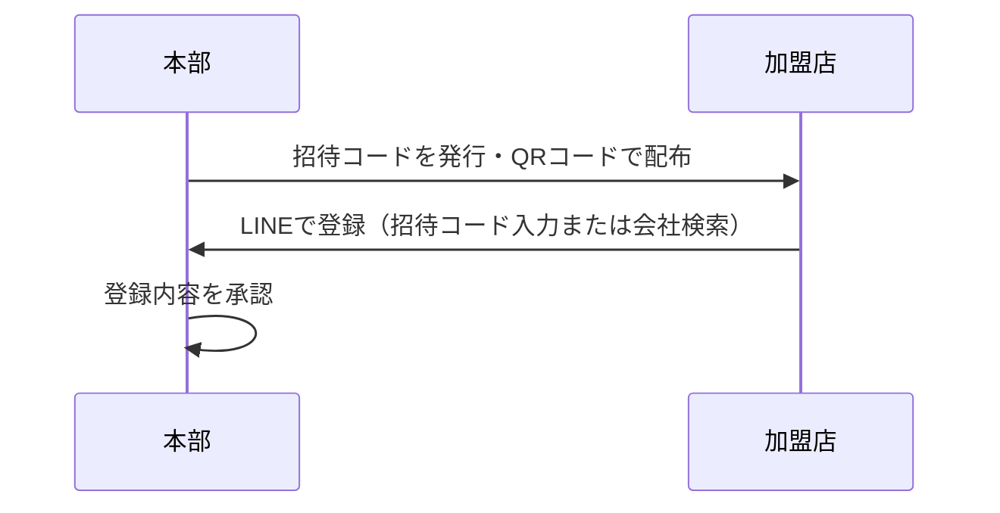
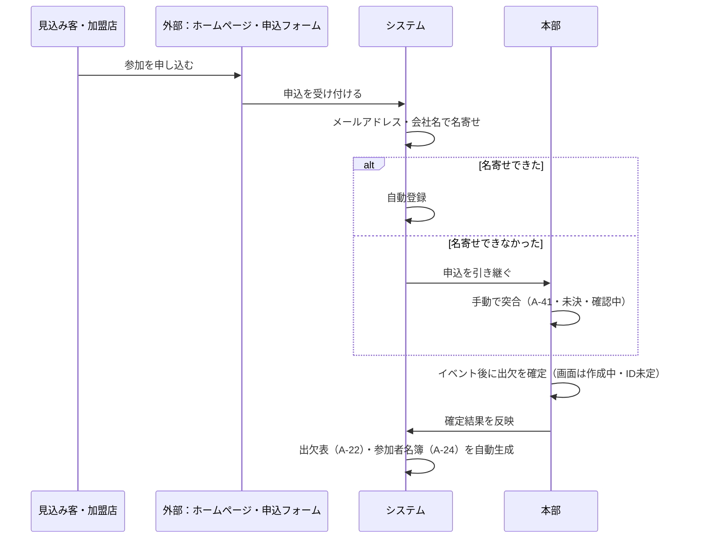
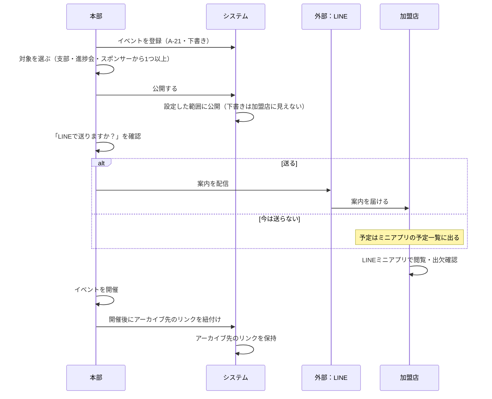
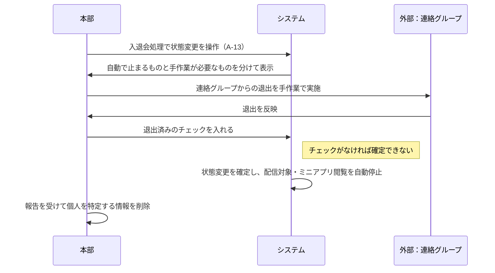
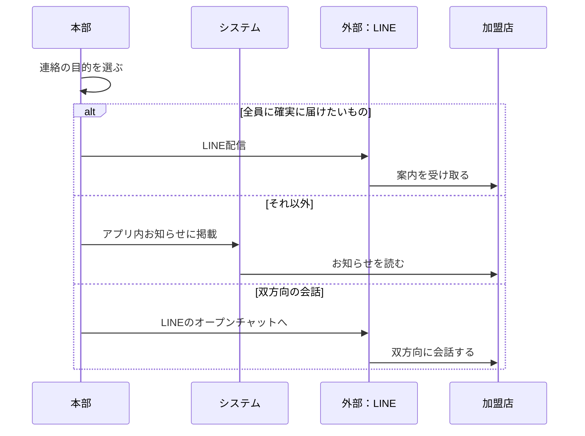
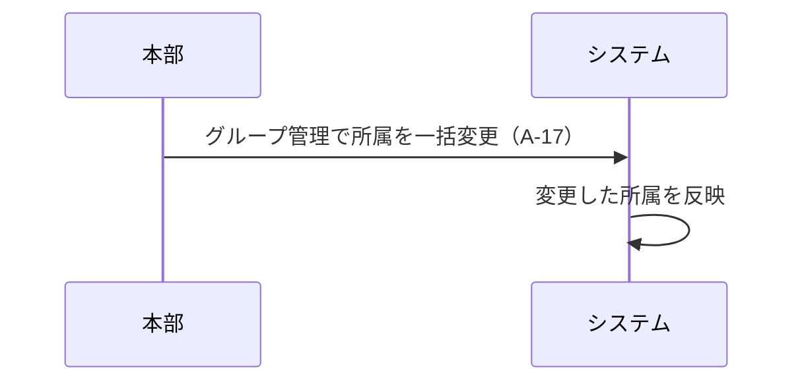

[← トップへ](./) ｜ [次の章へ →](04-functions.html)

# 3. 業務要件（フロー）

**この章で分かること**  
主な6つの業務について、担当ごとの作業と受け渡しの順番が分かります。

以下は実現する業務の流れです。担当ごとの列に分けた図（シーケンス図）で示します。現時点では見本データによる画面確認の段階で、外部連携は未接続です。

SV 活動の手順は、画面の設計が固まってから追加します。

## 1. 利用開始（招待→LINE登録→承認）

本部が招待コードを発行し、QR コードで配布します。加盟店は LINE で招待コードを入力するか会社を検索して登録し、本部が登録内容を承認します。高齢のメンバー向けに紙の手順書と説明会も併用します。

## 2. セミナー申込→取込→出欠確定

見込み客・加盟店がホームページや申込フォームから申し込みます。システムがメールアドレス・会社名で名寄せ（同じ人・会社の情報をまとめること）をして自動登録します。名寄せできなかった分は、本部が A-41 で手動突合（既存の名簿との照合）を行う予定ですが、進め方は未決・確認中です。イベント後、本部が出欠を確定すると（画面は作成中・ID未定）、出欠表（A-22）・参加者名簿（A-24）を自動生成します。この図のホームページは申込の入口を表しています。

## 3. イベント運営（登録→公開→通知→開催→アーカイブ）

本部が A-21 でイベントを登録します。登録した直後は下書きで、加盟店からは見えません。対象（支部・進捗会・スポンサーから1つ以上）を選んで公開すると、設定した範囲に加盟店へ公開されます。種別が導入セミナーのときだけ、対象を選ばずに保存でき、その場合は加盟店に見えず、次の LINE 送信の確認も出ません。公開の直後（下書きから公開に変えたときも含む）、本部に「LINE で送りますか？」の確認が出ます。確認にはメッセージの見本・送る相手と人数・今月の残り通数と送信後の通数を表示し、本部が了承すると LINE で案内を配信します。今は送らない場合も、予定はミニアプリの予定一覧に出て、あとから配信作成の画面（A-30）で送れます。すでに公開中の予定を編集しても、この確認は出ません。加盟店は LINE ミニアプリで閲覧・出欠確認を行います。開催後はアーカイブ（後から参照する資料の保管先）へのリンクだけを紐付け、既存のサービスは置き換えません。

## 4. 退会と遮断

本部が A-13 で状態変更を操作すると、自動で止まるもの（配信対象・ミニアプリ閲覧）と、手作業が必要なものを分けて表示します。連絡グループからの退出は、外部ツールに API（別のシステムから操作するための窓口）がないため自動化できません。本部が退出を実施し、確認のチェックを入れるまで確定できないようにします。

退会者・退職者のデータは、報告を受けて本部が削除します。個人を特定する情報の削除もこの運用に統一します。外部の公開サイトへのアクセス遮断は対象外です。

## 5. 連絡の振り分け

全員に確実に届けたいものは LINE 配信、それ以外はアプリ内お知らせ、双方向の会話は LINE のオープンチャット（複数人で会話する場）に振り分けます。

## 6. 年度替わりのグループ再編

年度替わりには、本部がグループ管理画面 A-17 で所属を一括変更します。名簿と所属表を別々に更新する手作業を減らします。「運営」はグループの名前ではなく、人に付く役割（ロール）です。

**未決・確認中**：システムで作ったイベントを自動でホームページにも掲載できるかは未確定です。この連携フローは図に含めず、確定後に追加します。

[← トップへ](./) ｜ [次の章へ →](04-functions.html)
