[← トップへ](./) ｜ [次の章へ →](05-non-functional.html)

# 4. 機能要件（一覧）

**この章で分かること**  
予定している機能と画面の対応、現在動いている構成、画面の見本が分かります。

## 機能一覧表

ドメインは業務のまとまり、マスタは基本情報、画面 ID は画面を識別する番号です。Webhook は外部サービスからシステムへ自動で通知を送る仕組み、パイプライン管理は見込み客への対応段階の管理、ダッシュボードは状況をまとめて見る画面を指します。SV（スーパーバイザー）は他の加盟店を支援する役割です。

画面IDの A- は本部の管理画面、S- は加盟店・スポンサー・SV が LINE の中で使うミニアプリの画面です。

| ドメイン | 機能 | 概要 | 使う人 | 画面ID | リリース区分 |
|---|---|---|---|---|---|
| マスタ・入退会 | 加盟店・スポンサー・利用者マスタ管理 | 会社や利用者の基本情報を登録・編集する | 本部（A-10・A-11 は SV・支部長も閲覧） | A-10〜A-15 | 第1弾 |
| マスタ・入退会 | グループ定義・所属の一括変更 | 支部・進捗会などの区分と所属をまとめて変更する | 本部 | A-17 | 第1弾 |
| マスタ・入退会 | 入退会処理 | 退会・退職の状態変更と、連絡グループ退出などの確認を行う | 本部 | A-13 | 第1弾 |
| マスタ・入退会 | 紐付け申請の承認 | ミニアプリからの紐付け申請を承認・却下する | 本部 | A-16 | 第1弾 |
| マスタ・入退会 | 利用者招待・LINEでの登録 | 招待コードを発行し、加盟店がLINEで登録する | 本部／加盟店・スポンサー・SV | A-15／S-02 | 第1弾／第2弾 |
| マスタ・入退会 | SV担当者の割り当て | SVと担当加盟店を割り当てる | 本部 | A-18 | 第1弾 |
| マスタ・入退会 | 会員名簿の相互閲覧（管理画面） | 氏名・役職・会社名・ロールを確認する | 本部・SV・支部長（A-15 は本部のみ） | A-11・A-15 | 第1弾 |
| マスタ・入退会 | 会員名簿の相互閲覧（ミニアプリ） | 氏名・役職・会社名・ロールを確認する | 加盟店・スポンサー・SV | S-12 | 第2弾 |
| マスタ・入退会 | マイページ | 氏名・役職・通知設定を確認・変更する | 加盟店・スポンサー・SV | S-13 | 第2弾 |
| マスタ・入退会 | 利用停止の案内 | 退会済みの利用者に閲覧できないことを案内する | 加盟店・スポンサー | S-17 | 第2弾 |
| ホーム | ホーム | 次の予定・新着お知らせ・自分の申込を一目で確認する | 加盟店・スポンサー・SV | S-04 | 第2弾 |
| イベント | イベント登録・公開 | イベントを下書きで登録し、対象を選んで公開する | 本部 | A-20／A-21 | 第1弾 |
| イベント | 公開直後のLINE送信の確認 | イベント公開直後に、LINEで送るかを本部が確認する | 本部 | A-21b | 第1弾 |
| イベント | イベントの年間一括取込 | 年間の予定をまとめて取り込む | 本部 | A-23 | 第1弾 |
| イベント | Googleカレンダー連携（未決・確認中） | 本部の運営カレンダーをイベントの月表示で見られるようにしたい、という方向だけが決まっている | 本部 | A-20 | 未決・確認中 |
| イベント | イベントの閲覧 | 加盟店がミニアプリでイベントを見る | 加盟店・スポンサー・SV | S-05／S-06 | 第2弾 |
| 申込・出欠 | 出欠確定 | イベント後に出欠を確定する（画面は作成中・ID未定） | 本部 | 作成中（ID未定） | 第1弾 |
| 申込・出欠 | 出欠表・参加者名簿の自動生成 | 出欠確定後に、出欠表・参加者名簿を自動生成する | 本部（SV・支部長の閲覧は未決・確認中） | A-22／A-24 | 第1弾 |
| 申込・出欠 | 自分の申込・出欠の確認 | 加盟店が自分の申込状況と出欠結果を確認する | 加盟店・スポンサー・SV | S-09 | 第2弾 |
| 申込フォーム連携 | 申込の自動登録 | 申込フォームからの申込を自動で登録する | 本部 | A-40 | 第1弾 |
| 申込フォーム連携 | 申込と会員の手動での突き合わせ（未決・確認中） | 名寄せできなかった申込を、既存の名簿と照らし合わせる進め方が未決 | 本部 | A-41 | 未決・確認中 |
| 連絡 | LINE配信・アプリ内お知らせの作成・対象絞り込み・通数監視 | 案内・リマインドをLINEで配信し、アプリ内のお知らせを作り、対象を絞り込み、通数を確認する | 本部 | A-30〜A-32 | 第1弾 |
| 連絡 | オープンチャットの管理 | オープンチャットのURL・参加コードを管理し、退会時に退出のチェックリストを出す | 本部 | A-19 | 第1弾 |
| 連絡 | アプリ内お知らせ・オープンチャットの利用 | お知らせを読み、オープンチャットに参加する | 加盟店・スポンサー・SV | S-10／S-11／S-19 | 第2弾 |
| SV活動 | 面談記録・チェック項目進捗・連絡ログ | SVの活動を構造化して記録する | 本部・SV | A-70〜A-72 | 第3弾 |
| SV活動 | SV向けの面談記録・チェック項目 | SVがミニアプリで自分の活動を記録・確認する | SV | S-14〜S-16 | 第3弾 |
| 見込み客・活動状況 | パイプライン管理・月次の活動状況 | 見込み客への対応状況を段階で管理する | 本部・SV（A-82 は本部のみ） | A-80〜A-82 | 第3弾 |
| 資料・アーカイブ | 資料の添付（未決・確認中） | 資料をどこから配るかが未確認で、機能とするかどうかも未決 | 本部 | A-90 | 未決・確認中 |
| 資料・アーカイブ | アーカイブ先へのリンク紐付け | 開催後の資料をアーカイブ先に紐付け、加盟店が閲覧できるようにする | 本部／加盟店・スポンサー | A-21／S-06 | 第1弾／第2弾 |
| 加盟店案件管理（検討中） | 実績・案件管理、集計 | 加盟店ごとの案件を管理する（契約未定のオプション） | 加盟店（本部・SV閲覧） | A-95／A-96 | 第4弾（オプション・契約未定） |

表のリリース区分は段階的な計画の区分です。第2弾は加盟店向けの LINE ミニアプリ（LINE の中で使える画面）が中心で、SV 向けの面談記録・チェック項目は第3弾です。段階的な計画の扱いは[1章](01-purpose-scope.html)の確認事項です。

イベントの種別は「進捗会・支部会議・導入セミナー・その他（本部・SV会議を含む）」です。初期状態は下書きで、加盟店からは見えません。「この予定を公開する」にチェックを入れたときだけ公開されます。対象は支部・進捗会・スポンサーから1つ以上を選び、部署は配信の絞り込みに使います。導入セミナーだけは対象なしで保存でき、加盟を検討中の方向けのため加盟店には見えず、LINE 送信の確認も出ません。

公開状態での作成直後や、下書きから公開への変更直後に「LINEで送りますか？」と確認します。メッセージの見本（プレビュー）、送る相手と人数、今月の LINE 配信の残り通数と送信後の通数を表示し、本部が了承すると送信します。「今は送らない」を選んでもミニアプリの予定一覧には表示され、あとから A-30 で追加配信できます。すでに公開中のイベントを編集した場合には、この確認は出ず、送り直しは A-30 で行います。

**未決・確認中**：Googleカレンダー連携は、本部の運営カレンダーをイベントの月表示で見られるようにしたい方向のみ決定しており、連携するアカウントや範囲（読むだけか、双方向か）は未決です。資料の添付（A-90）は配布元が未確認で、機能として作るかも未決です。申込と会員の手動での突き合わせ（A-41）も進め方は未決です。

カレンダー連携に、加盟店個人のカレンダーへの自動登録は含めません。アーカイブは資料を後から参照するための保管で、既存のアーカイブ先サービスにはリンクだけを紐付けます。

**未決・確認中**：加盟店案件管理を実装するかは、契約が未定のため先方担当への確認が必要です。

## 参考：機能と配置イメージ

### 現在のシステム配置図

ホスティングとは、インターネットから画面を利用できるようにすることです。Next.js は管理画面を作る開発基盤、GitHub はプログラムを管理するサービス、デプロイはプログラムを動かす場所へ反映することを指します。

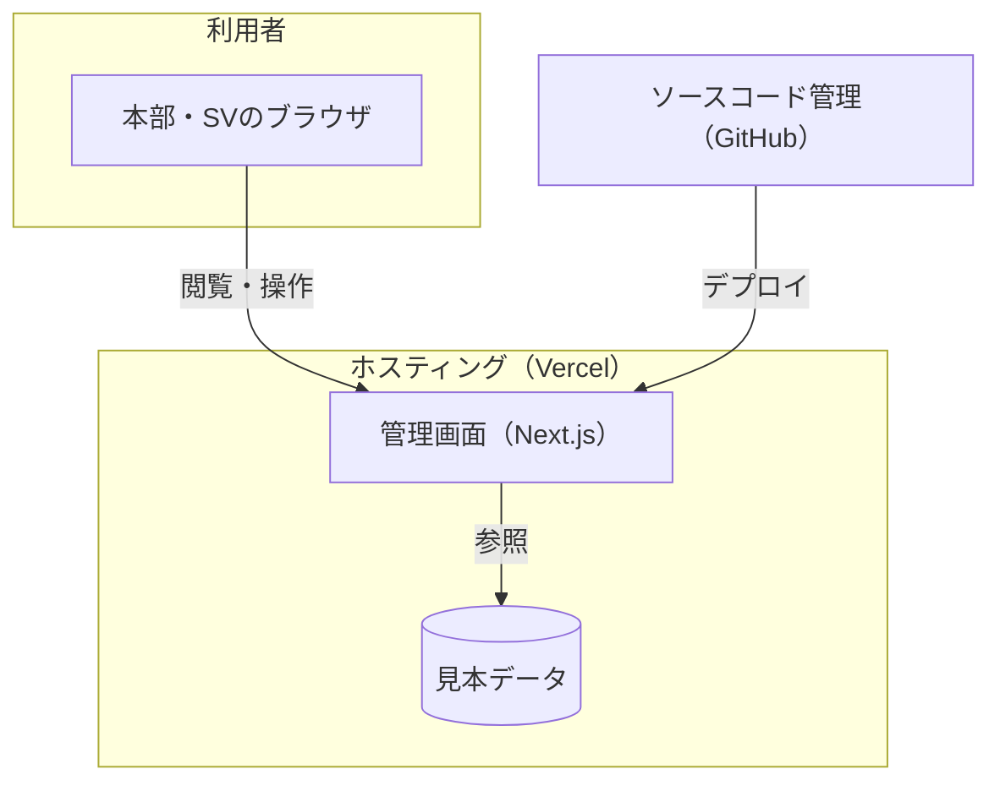

現在はデータベースや外部サービスとの接続をまだ行っておらず、見本データで画面を確認できる段階です。ログイン機能もまだありません。

### 画面の画像

以下の画像はサンプルデータで作成されたものです。「この画面でできること」は完成時に想定する操作を説明しており、実際の保存・配信・外部連携が動作することを示すものではありません。

#### A-10：加盟店一覧

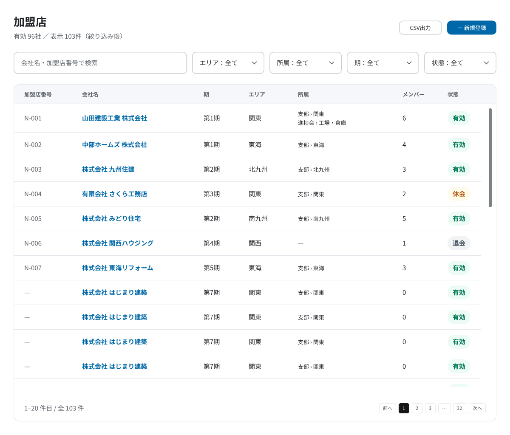

**この画面でできること**：加盟店を一覧で確認します。  
**対応する機能**：加盟店マスタの管理。
（画面の中の会社名・人名・数字は見本です）

#### A-11：加盟店詳細

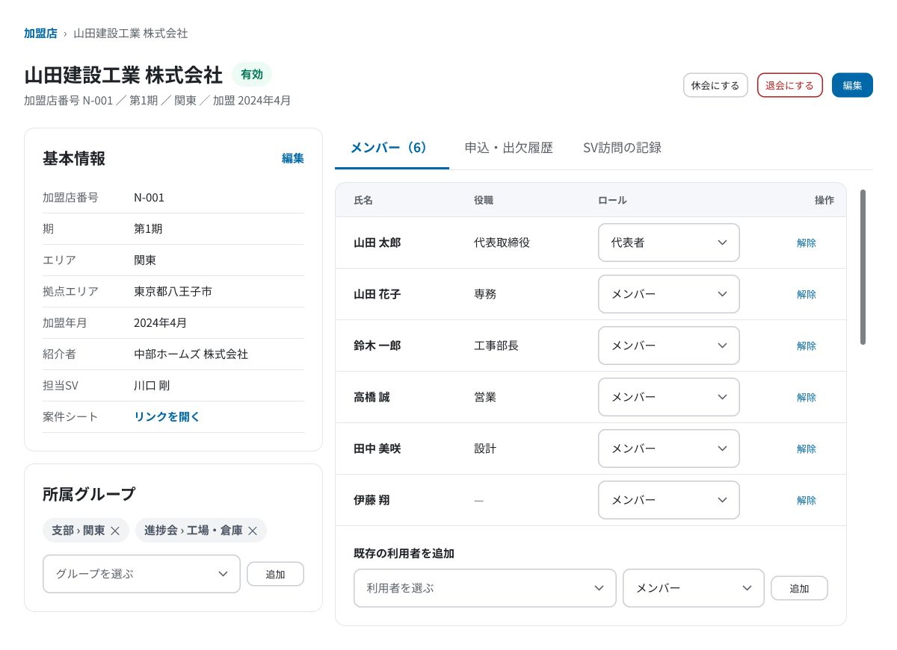

**この画面でできること**：加盟店の詳細情報を確認します。  
**対応する機能**：加盟店マスタの管理。
（画面の中の会社名・人名・数字は見本です）

#### A-12：加盟店の新規登録

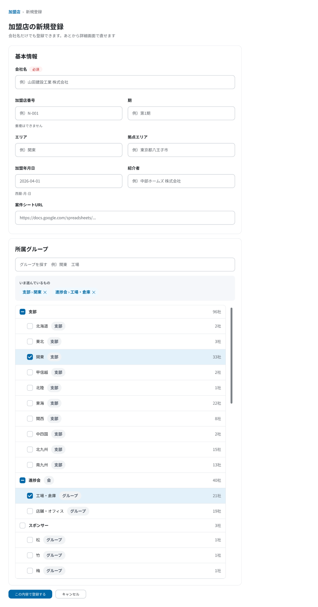

**この画面でできること**：新しい加盟店の基本情報を登録します。  
**対応する機能**：加盟店マスタの管理。
（画面の中の会社名・人名・数字は見本です）

#### A-13：退会の確認

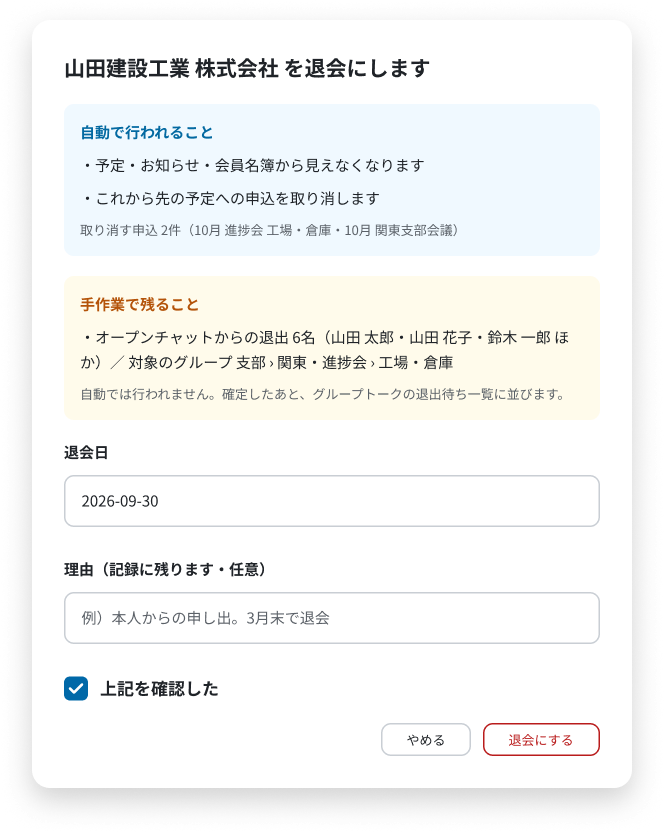

**この画面でできること**：退会の確認ダイアログです。自動で行われることと、連絡グループからの退出など手作業で残ることを、退会を確定する前に確認します。  
**対応する機能**：入退会処理とアクセス遮断。
（画面の中の会社名・人名・数字は見本です）

#### A-14：スポンサー

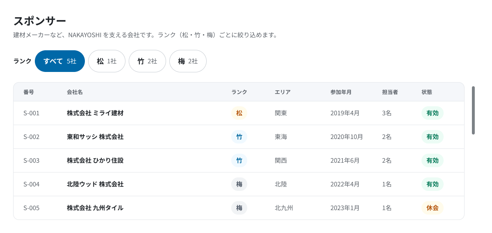

**この画面でできること**：協賛企業の情報を管理します。  
**対応する機能**：スポンサーマスタの管理。
（画面の中の会社名・人名・数字は見本です）

#### A-15：利用者一覧

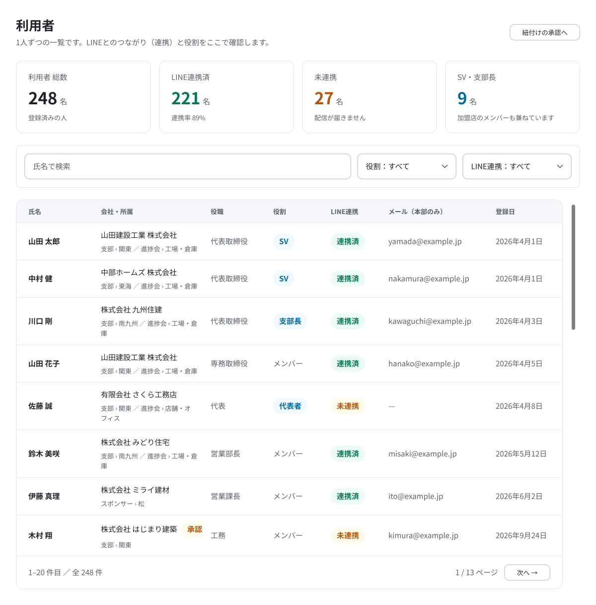

**この画面でできること**：利用者を一覧で確認します。  
**対応する機能**：利用者マスタの管理。
（画面の中の会社名・人名・数字は見本です）

#### A-17：グループ管理

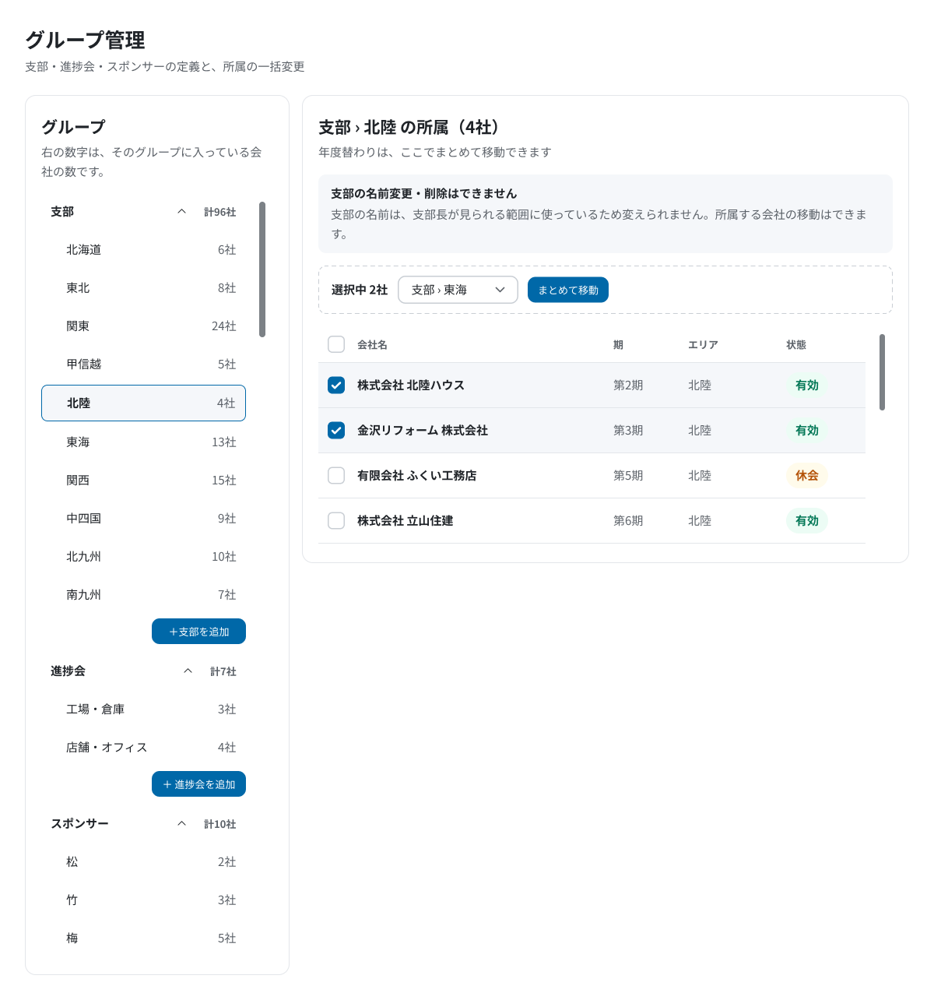

**この画面でできること**：グループと所属を管理し、年度替わりに所属を一括変更します。  
**対応する機能**：グループ定義と所属の管理。
（画面の中の会社名・人名・数字は見本です）

#### A-18：SV担当者

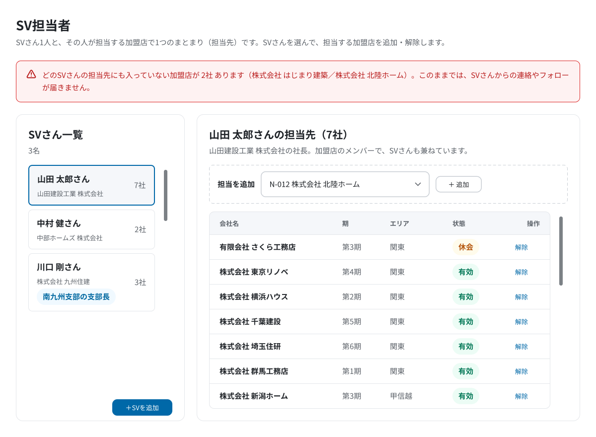

**この画面でできること**：加盟店を支援する SV 担当者を確認します。  
**対応する機能**：マスタ・入退会領域の担当者管理。
（画面の中の会社名・人名・数字は見本です）

#### A-20：イベント一覧

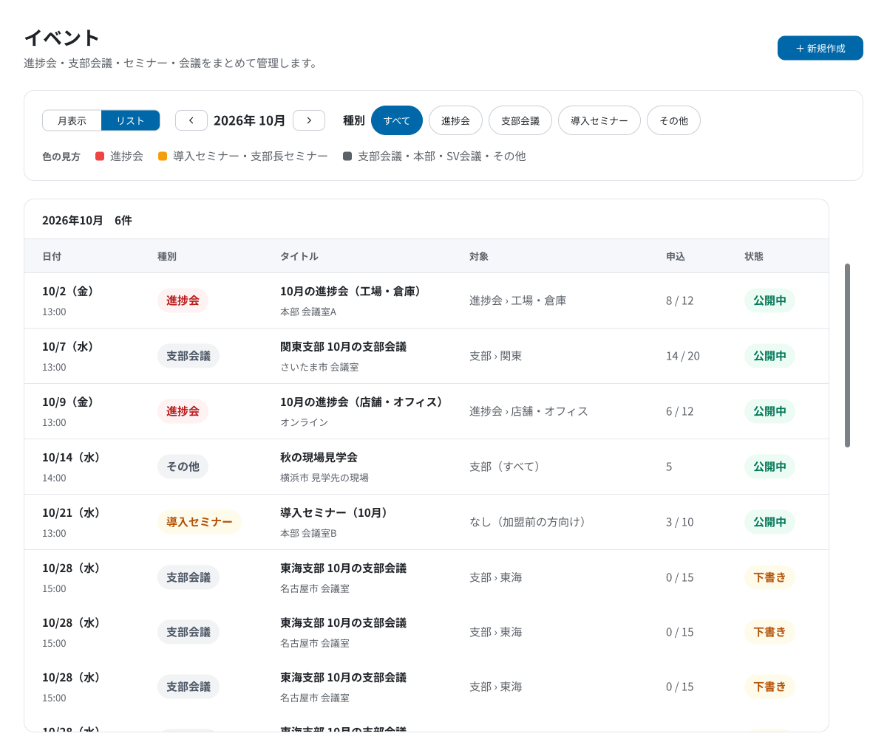

**この画面でできること**：登録したイベントを一覧で確認します。対象の欄には「支部 › 関東」「進捗会 › 工場・倉庫」、導入セミナーの場合は「なし（加盟前の方向け）」のように表示され、状態の欄で下書き・公開中がわかります。  
**対応する機能**：イベントの管理。
（画面の中の会社名・人名・数字は見本です）

#### A-20：イベントの月表示

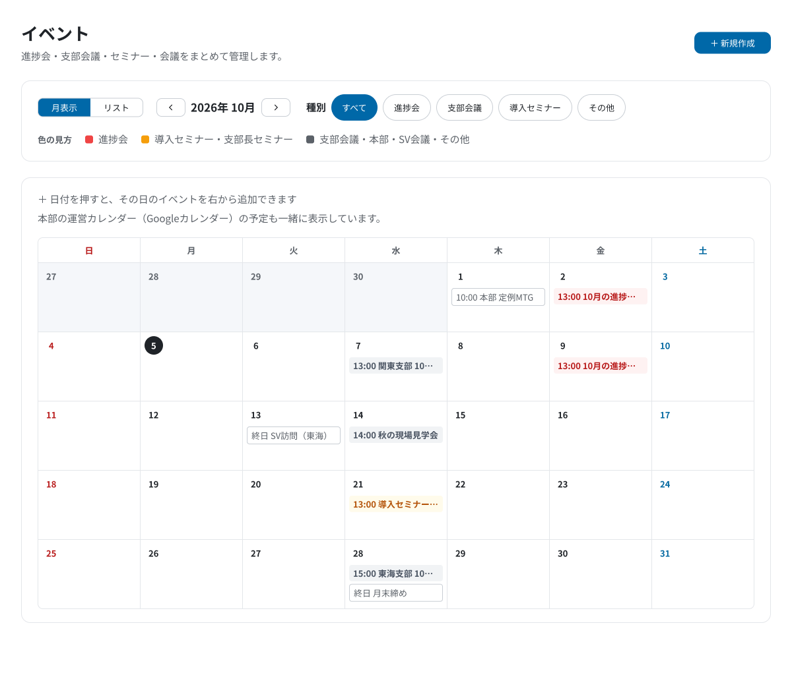

**この画面でできること**：イベントの予定を月ごとに確認します。本部の運営カレンダーを Googleカレンダー連携でこの画面で見られるようにしたい、という方向で検討中です（未決・確認中）。  
**対応する機能**：イベントの管理。
（画面の中の会社名・人名・数字は見本です）

#### A-21：イベント作成

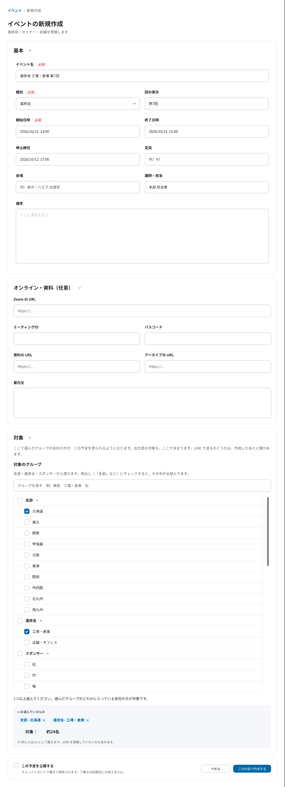

**この画面でできること**：イベントを下書きで登録し、対象を選び、「この予定を公開する」にチェックを入れて公開します。導入セミナーだけは対象なしで保存でき、加盟店には見えず、LINE 送信の確認も出ません。  
**対応する機能**：イベント登録・公開範囲・通知設定。
（画面の中の会社名・人名・数字は見本です）

#### A-21b：作成後のLINE送信の確認

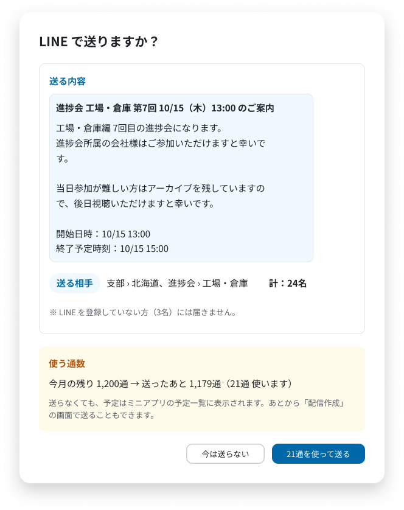

**この画面でできること**：公開状態でのイベント作成直後や下書きから公開への変更直後に、LINE 送信を確認します。メッセージの見本・送る相手と人数・今月の残り通数と送信後の通数を確認して送信できます。「今は送らない」を選んでも予定一覧に表示され、あとから A-30 で送れます。導入セミナーや、すでに公開中のイベントの編集では、この確認は出ません。  
**対応する機能**：イベント通知と LINE 配信。
（画面の中の会社名・人名・数字は見本です）

#### A-22：出欠表

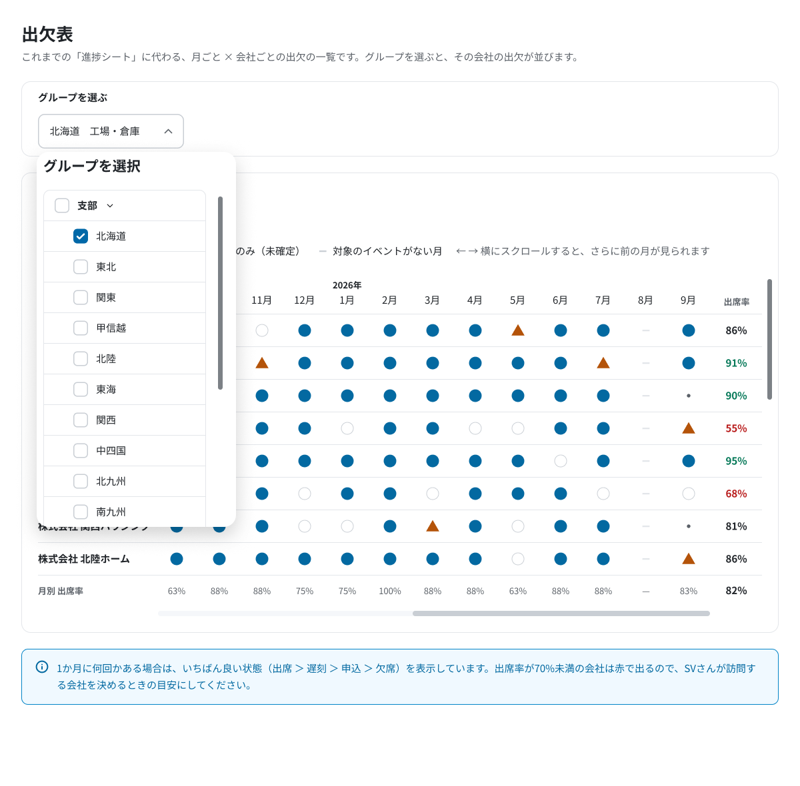

**この画面でできること**：出欠表を確認します。出欠の確定は別の画面（作成中・ID未定）で行います。  
**対応する機能**：出欠表（会社×月の出欠の一覧）。
（画面の中の会社名・人名・数字は見本です）

#### A-24：参加者名簿

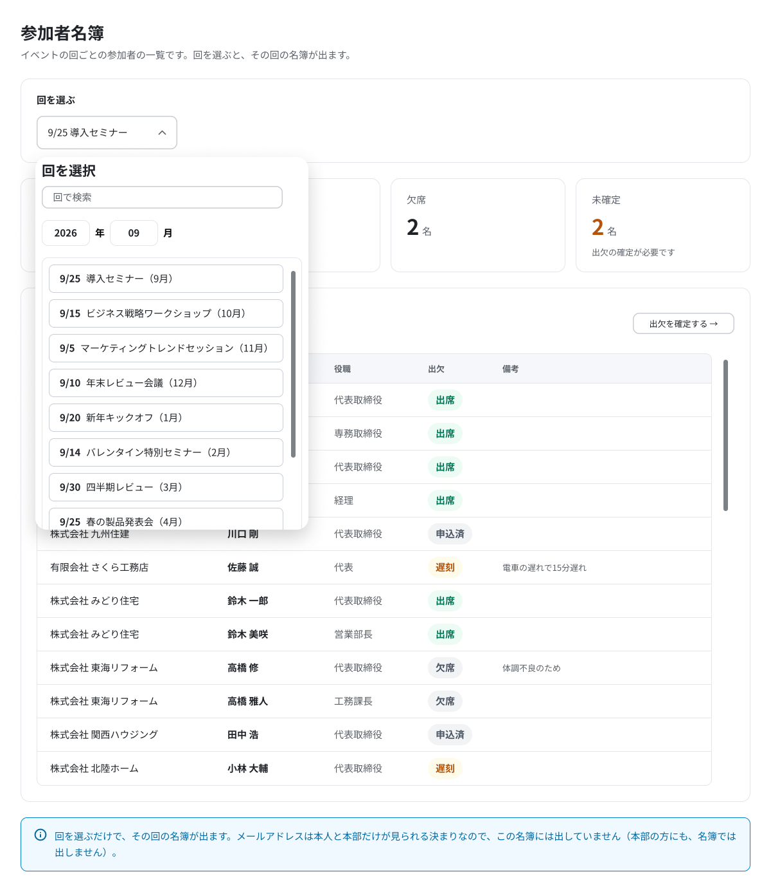

**この画面でできること**：参加者名簿を確認します。  
**対応する機能**：出欠確定後の参加者名簿自動生成。
（画面の中の会社名・人名・数字は見本です）

#### A-30：配信作成

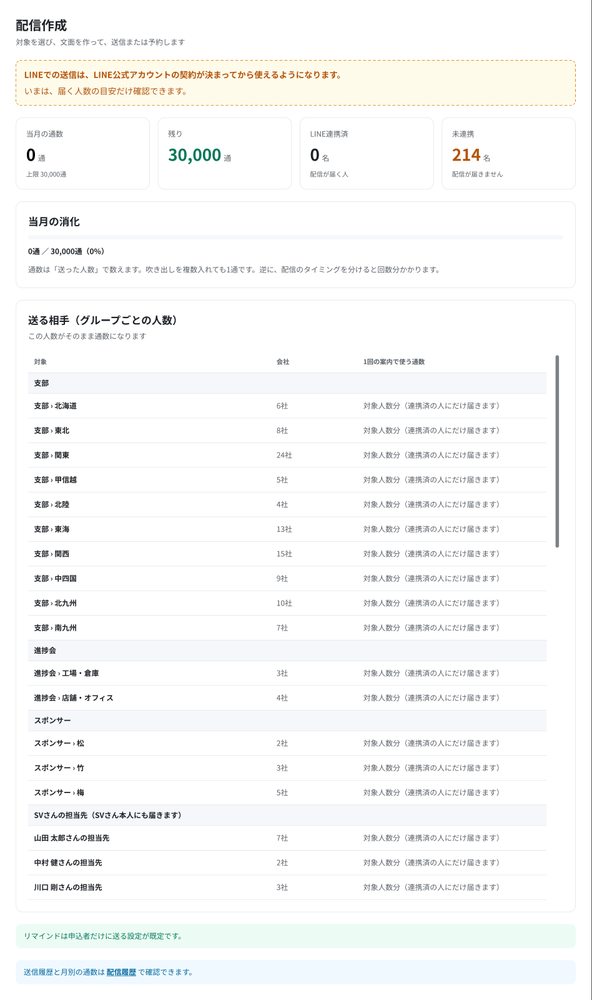

**この画面でできること**：案内・リマインドの配信を作成し、対象を絞り込みます。部署ごとの絞り込みは、この画面に追加する予定です（現時点ではまだありません）。  
**対応する機能**：LINE 配信・対象絞り込み。
（画面の中の会社名・人名・数字は見本です）

[← トップへ](./) ｜ [次の章へ →](05-non-functional.html)
