[← トップへ](./)

# 8. 機能一覧（やりたいことと機能）

**この章で分かること**  
管理画面とアプリ（LINE ミニアプリ）でできることを、「やりたいこと」と、それを叶える「システムの機能」の両方から一覧で確認できます。

2026-10-28 作成。4章までの内容（2026-09-30 時点）に、その後の決定（2026-10-01〜10-22）を反映しています。画面の番号は、いまの画面デザイン（Figma）の番号です。4章の画面番号とは一部ちがいます。

画像は画面デザインの見本で、押すと大きく表示されます。画面の中の会社名・人名・数字はすべて見本です。

**状態の見方**

| 状態 | 意味 |
|---|---|
| 確定 | 4章までの内容のとおり |
| 確定（変更あり） | 2026-10-01 以降の決定で、中身が変わった |
| 未決 | 方針や進め方が、まだ決まっていない |
| やめた | 決定により、作らないことになった |

## 管理画面でできること

使う人は本部が中心です。SV・支部長は一部を見るだけです。

| やりたいこと | 使う人 | システムの機能 | 画面 | 状態 | 画面の画像 |
|---|---|---|---|---|---|
| 管理画面に入れる人を、本部が許可した人だけにしたい | 本部・SV・支部長 | 利用の申請（メールとお名前だけ）→ 本部が役割を選んで許可 → 1回だけ使えるリンクをメールで送る（24時間有効）→ リンクからパスワードを決める（8文字以上・大文字・小文字・数字）。パスワードの再設定は本人だけで完結（リンクは1時間有効） | A-01〜A-01i・B-15 | 確定（変更あり） | <a href="assets/features/a01-login.png">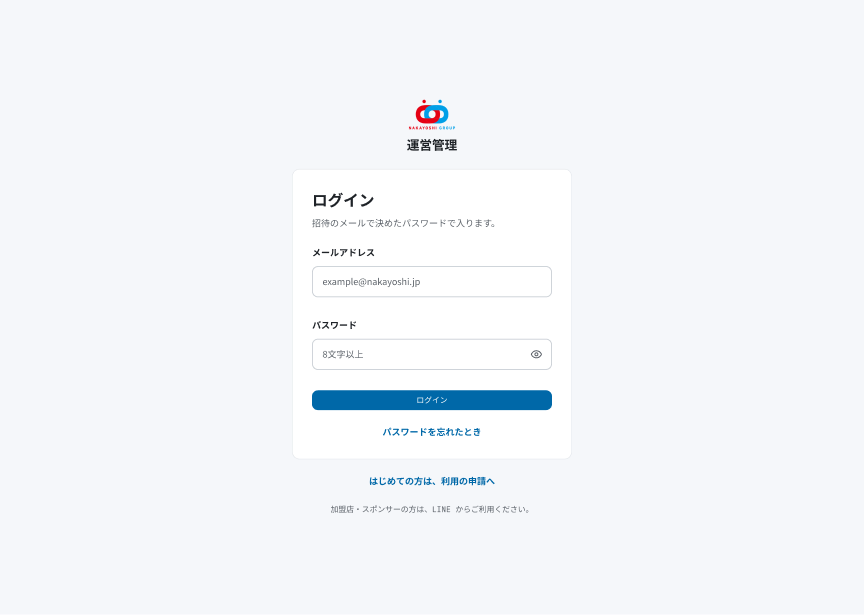</a> <a href="assets/features/b15-login-requests.png">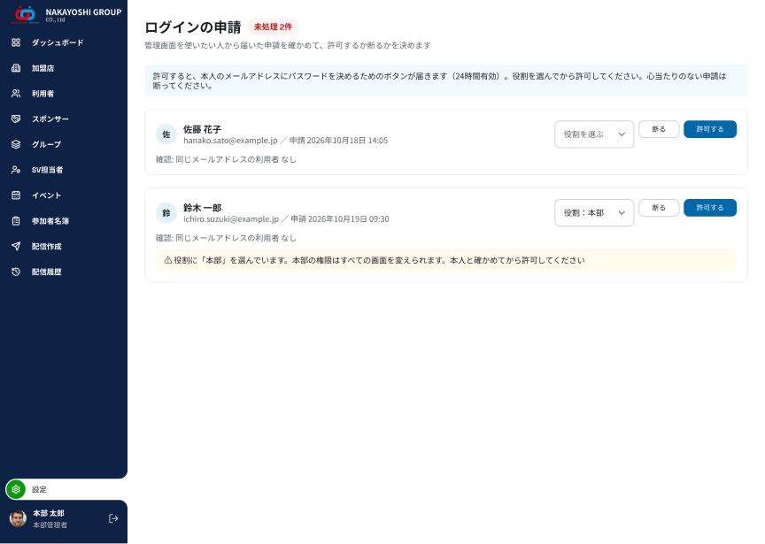</a> |
| 全体の様子をひと目で見たい | 本部 | ダッシュボード（指標・月別の配信通数・エリアの地図）。出席率のグラフは保留 | A-00 | 確定 | <a href="assets/features/a00-dashboard.png">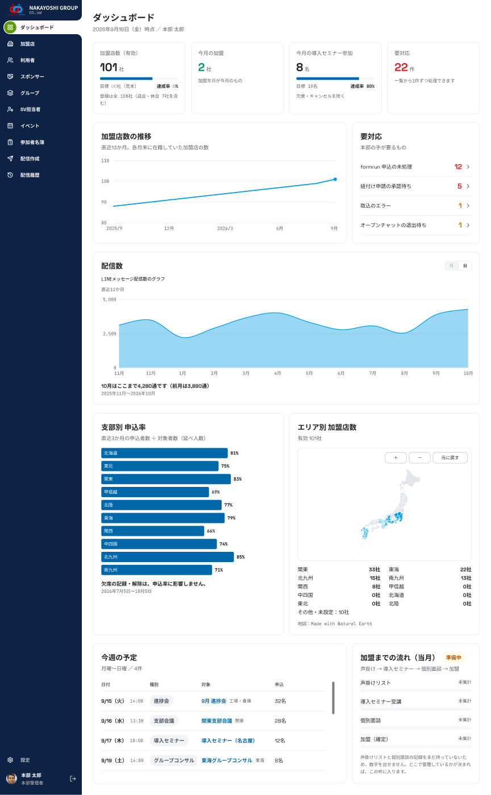</a> |
| 加盟店を登録して、情報を最新にしておきたい | 本部（SV・支部長は見るだけ） | 加盟店の一覧・検索・CSV 出力、新規登録・編集（所属の支部・紹介者・担当 SV は一覧から選ぶ）、所属の追加・解除 | A-10・A-11・A-12 | 確定（変更あり） | <a href="assets/features/a10-organizations.png">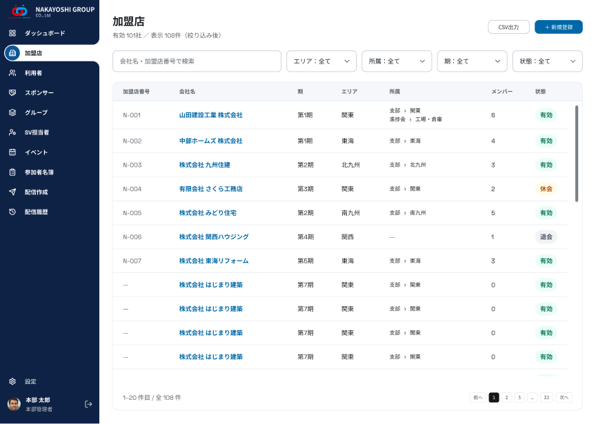</a> |
| 退会した人が、もう見られないようにしたい | 本部 | 休会・退会の状態変更。「自動で止まるもの」と「手作業が要るもの」を分けて表示し、連絡グループから外したチェックがないと確定できない。確定すると配信とアプリの閲覧が自動で止まる | A-13 | 確定 | <a href="assets/features/a13-withdrawal.png">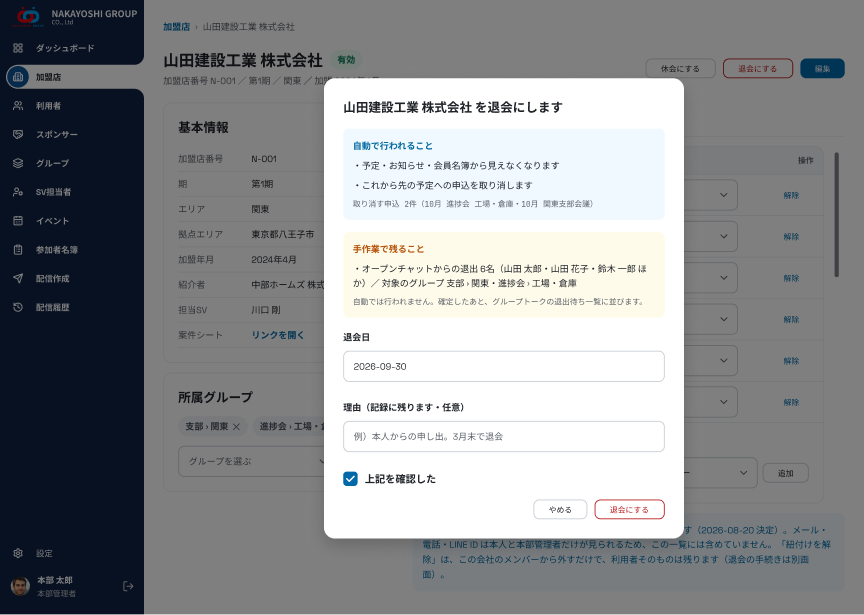</a> |
| スポンサーを管理したい | 本部 | 一覧・詳細・新規登録。番号は自動で付き、紹介者は利用者から選ぶ。契約区分（松・竹・梅）は1社に1つ。「退会にする」と「有効に戻す」だけで、休会はない | A-20・A-21・A-22 | 確定（変更あり） | <a href="assets/features/a20-sponsors.png">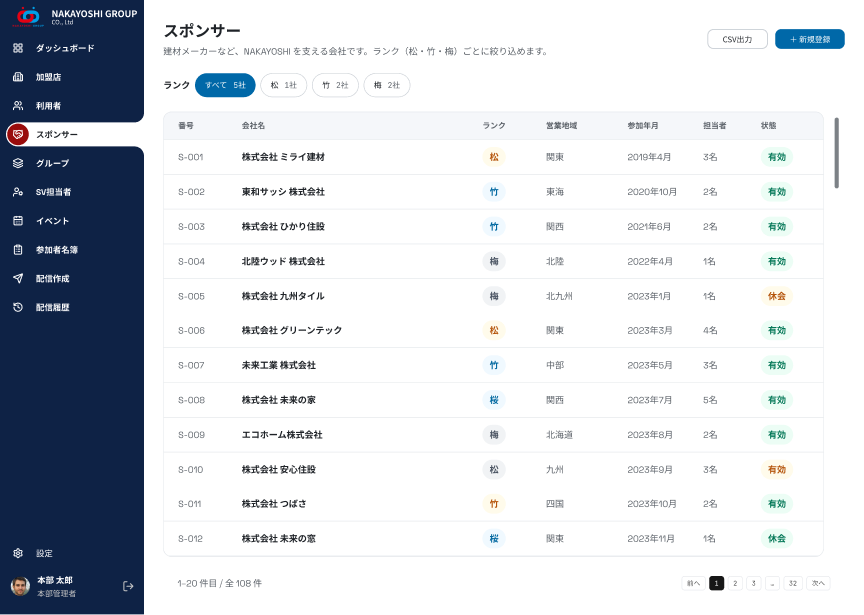</a> |
| 社員（利用者）を管理したい | 本部 | 利用者の一覧・詳細、役割の付与（1人に複数付けられる）、利用を止める | A-30・A-31 | 確定 | <a href="assets/features/a30-users.png">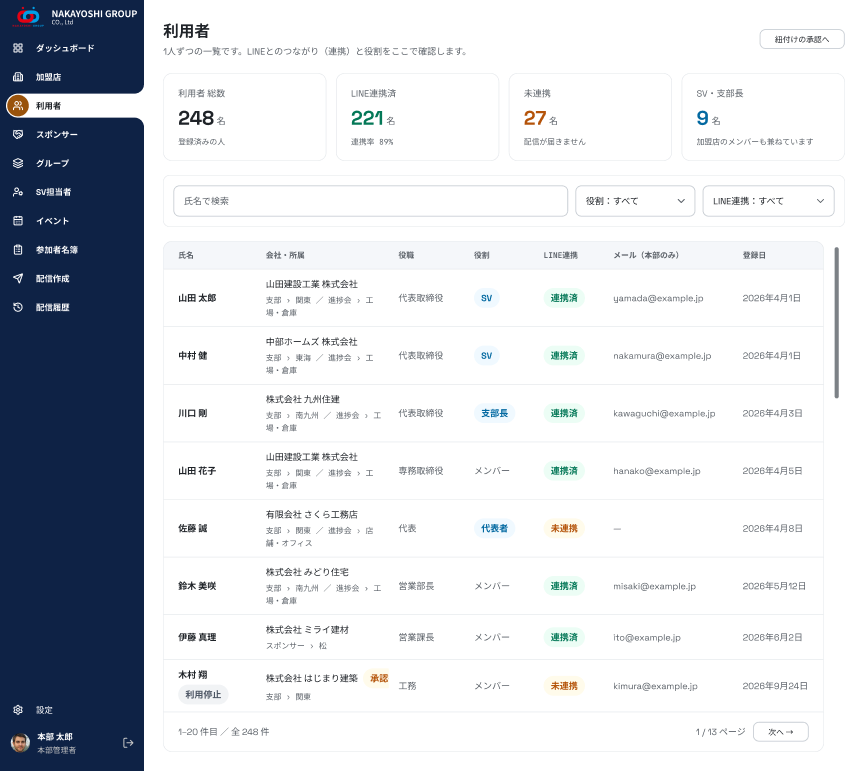</a> |
| LINE で登録してきた人を、正しい会社に結び付けたい | 本部 | 紐付けの申請を承認・却下する | B-11 | 確定 | <a href="assets/features/b11-link-approval.png">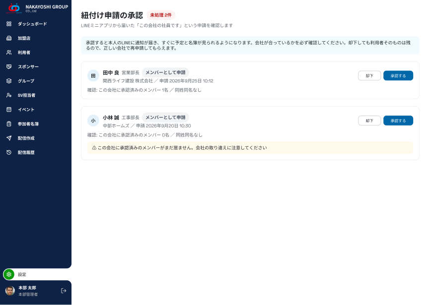</a> |
| 年度替わりに、支部・進捗会の所属をまとめて変えたい | 本部 | グループ（支部・進捗会・スポンサー）の定義と、会社のまとめての移動。「支部」などのまとめ行は所属先にはできず、対象選びでだけ選べる | A-40 | 確定 | <a href="assets/features/a40-groups.png">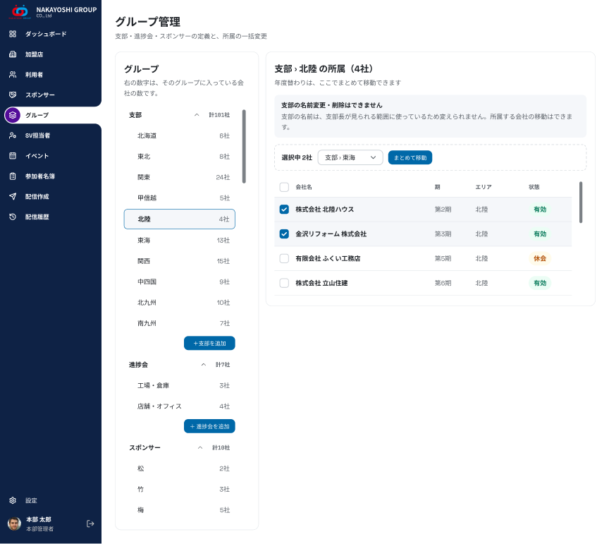</a> |
| SV がどの加盟店を担当するか決めたい | 本部 | SV と担当加盟店の割り当て・解除 | A-50 | 確定 | <a href="assets/features/a50-sv.png">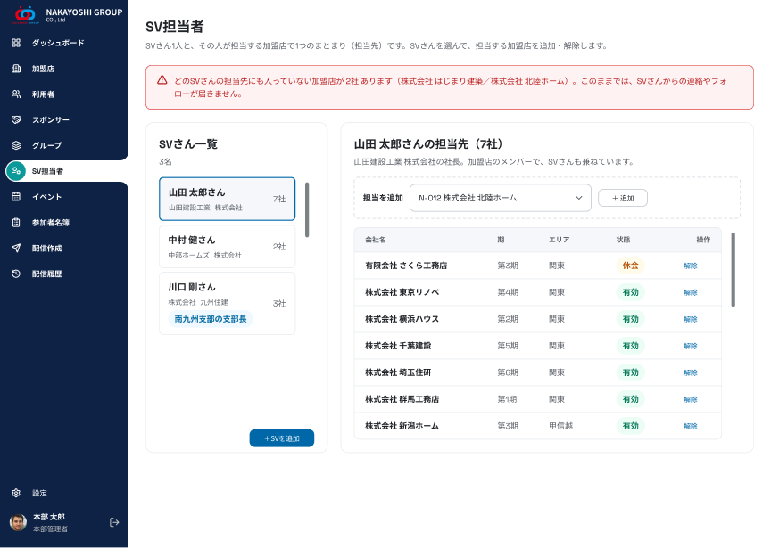</a> |
| セミナーや進捗会の予定を作って、対象の人に見せたい | 本部 | 予定の一覧（表・月表示）と作成・編集。最初は下書きで、「この予定を公開する」で公開。対象は支部・進捗会・スポンサー・部署のどれかに当てはまる人で、選ばなければ本部だけが見る。講師は利用者から選ぶか文字で入力。備考＝加盟店向けの案内文。セミナーは HP の申込ページの URL、進捗会は Zoom の URL を入れる。「共有しない」にすると、アプリに出さず運営だけが見る | A-60・A-60b・A-61 | 確定（変更あり） | <a href="assets/features/a60-events.png">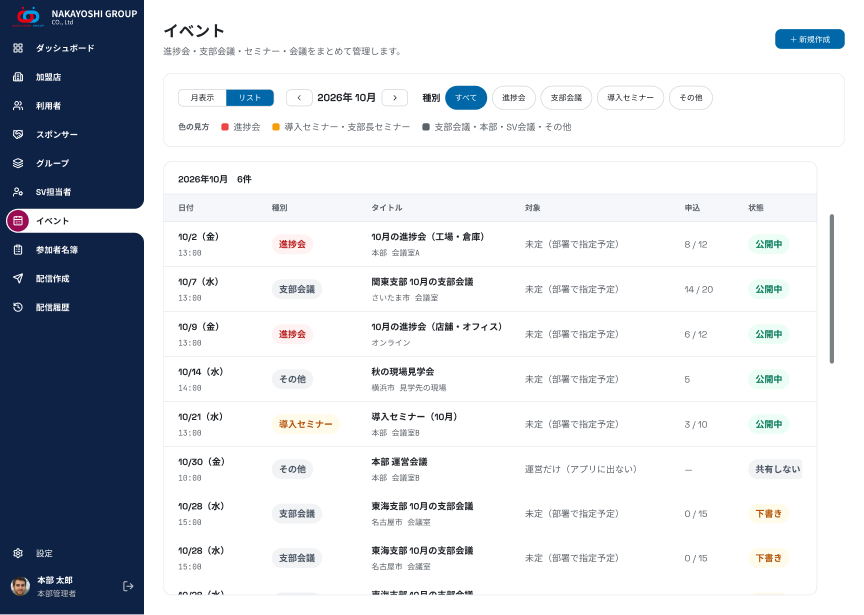</a> <a href="assets/features/a61-event-form.png">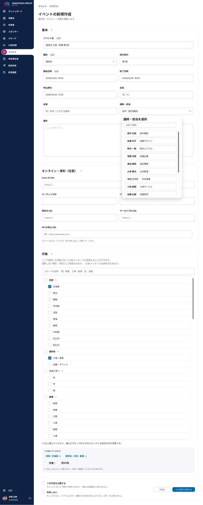</a> |
| 公開したら LINE で知らせるか、その場で決めたい | 本部 | 新しく公開したときだけ「LINE で送りますか？」を出す。メッセージの見本・送る相手と人数・今月の残り通数と送ったあとの通数を表示。「今は送らない」でも予定はアプリに出る | A-62 | 確定 | <a href="assets/features/a62-line-confirm.png">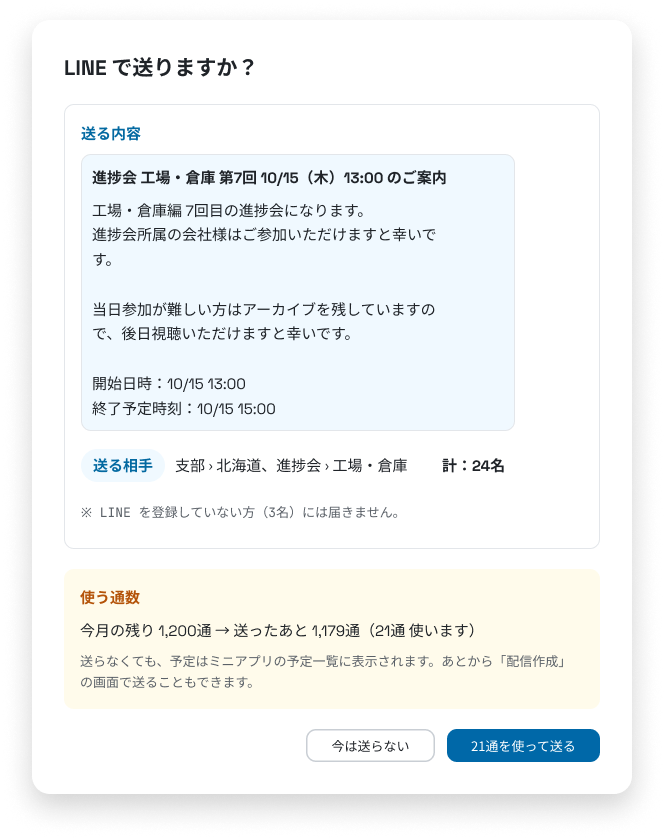</a> |
| 誰が申し込んだか、予定ごとに見たい | 本部 | 予定の詳細で申込者を一覧（申込済み・欠席の変更）、参加者名簿 | A-63・A-80 | 確定（変更あり） | <a href="assets/features/a63-event-detail.png">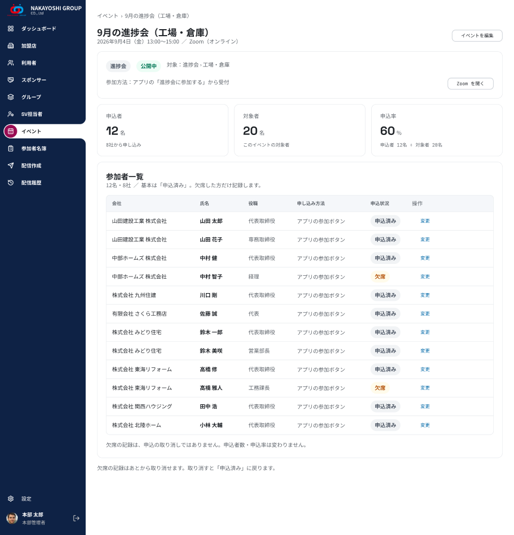</a> |
| HP から入ったセミナーの申込を、手入力せずに取り込みたい | 本部 | 申込フォーム（formrun）の申込を自動で受け取り、メールアドレスで利用者と結び付ける。結び付かなかった申込は本部が手で結び付ける（進め方は未決） | B-13 | 一部未決 | <a href="assets/features/b13-formrun.png">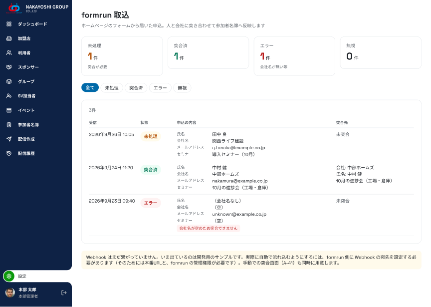</a> |
| 進捗会に実際に出た人（出席）を知りたい | 本部 | Zoom の参加者を会員と照らし合わせる。方式は検討中 | なし | 未決 | — |
| ~~出欠を確定して、出欠表を作りたい~~ | 本部 | 出欠の確定、出欠表の自動作成、会社ごとの参加回数。申込の流れでは出席が取れないため、作らないことにした | なし | やめた | — |
| LINE で、必要な人にだけ連絡したい | 本部 | 配信の作成（下書きあり・本文 5,000 字まで、書式はリンク・番号付きリスト・箇条書きの3つ）、部署などで送る相手を絞る | A-90・A-91 | 確定（変更あり） | <a href="assets/features/a91-notification-form.png">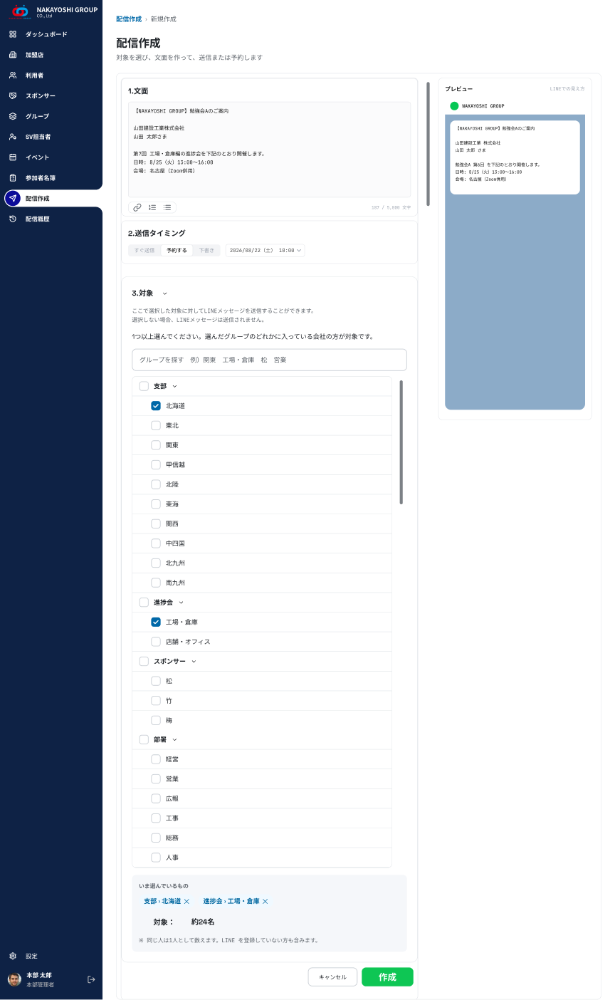</a> |
| LINE の通数を使いすぎないようにしたい | 本部 | 配信の履歴、当月の消化、月別の通数グラフ | B-00 | 確定 | <a href="assets/features/b00-history.png">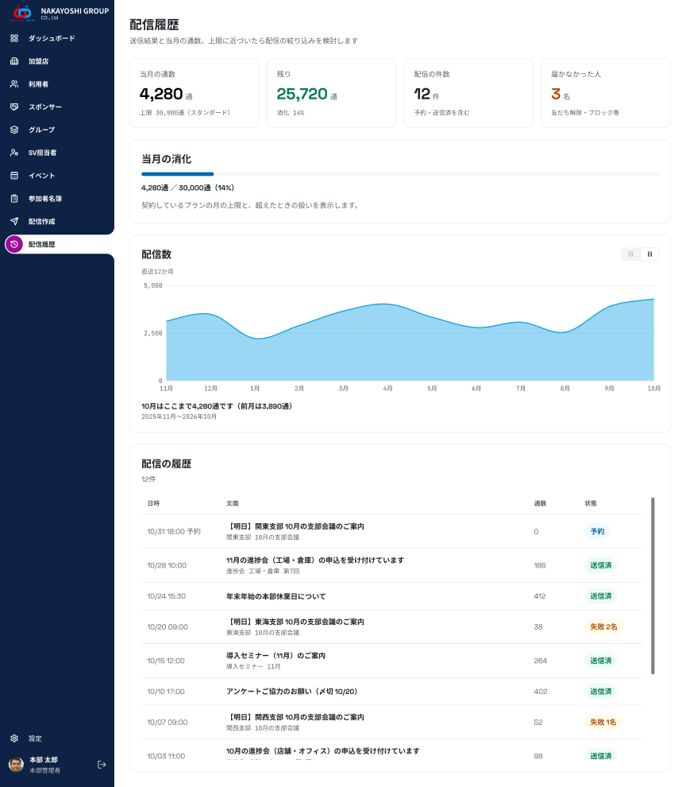</a> |
| 全員に送るほどでない連絡は、アプリのお知らせで済ませたい | 本部 | アプリ内お知らせの作成 | 配信作成のなか | 確定 | — |
| オープンチャット（グループトーク）を管理したい | 本部 | URL・参加コードの管理、退会のときに退出のチェックリストを出す | B-12 | 確定 | <a href="assets/features/b12-group-talk.png">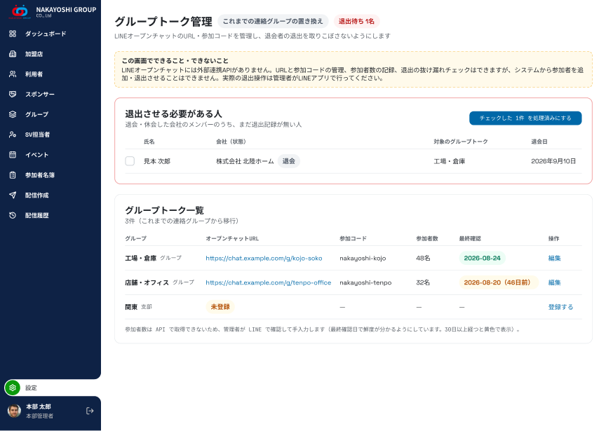</a> |
| 開催後の資料を、あとから見られるようにしたい | 本部 | アーカイブ先（HP）へのリンクを予定に付ける | A-61 | 確定 | — |
| 年間の予定をまとめて入れたい | 本部 | 年間の予定の一括取り込み（画面はまだない） | 未作成 | 確定 | — |
| SV の面談・訪問を記録して、本部でも見たい | 本部・SV | 面談記録・チェック項目の進み具合・連絡ログ（第3弾） | 未作成 | 確定 | — |
| 見込み客への対応を段階で管理したい | 本部・SV | 見込み客の段階管理・月次の活動状況（第3弾） | 未作成 | 確定 | — |
| 誰がいつ何をしたか、あとで調べたい | 本部 | 操作の記録（ログ管理） | B-14 | 確定 | <a href="assets/features/b14-logs.png">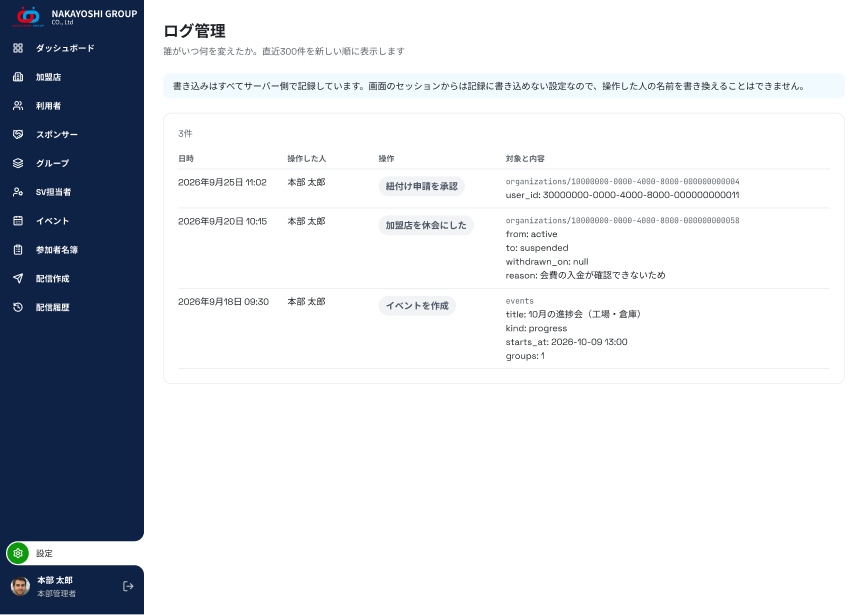</a> |
| 本部の運営カレンダーを、月表示で一緒に見たい | 本部 | Google カレンダーとの連携。アカウントと範囲（読むだけか、両方向か）が未決 | A-60b | 未決 | <a href="assets/features/a60b-events-month.png">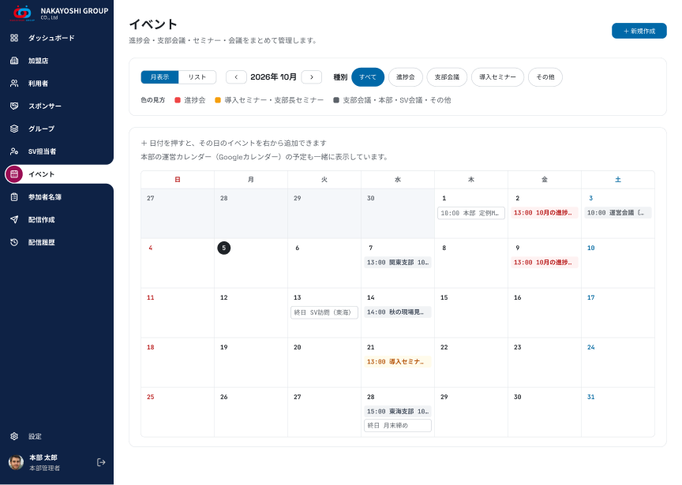</a> |
| 資料をシステムから配りたい | 本部 | 資料の添付。配布元が未確認で、作るかどうかも未決 | なし | 未決 | — |
| 加盟店ごとの案件を管理したい | 加盟店（本部・SV は見るだけ） | 実績・案件の管理と集計（契約が未定のオプション） | なし | 未決 | — |

## アプリ（LINE ミニアプリ）でできること

使う人は、加盟店の社長・担当者、一般社員、SV、スポンサーです。下のメニューはホーム・予定・Info・マイページの4つで、文字は全部のタブに出します。

| やりたいこと | 使う人 | システムの機能 | 画面 | 状態 | 画面の画像 |
|---|---|---|---|---|---|
| 新しいパスワードを覚えずに使いたい | 全員 | LINE で開くと、そのまま本人と分かる（LINE 認証） | S-01 | 確定 | <a href="assets/features/s01-launch.png">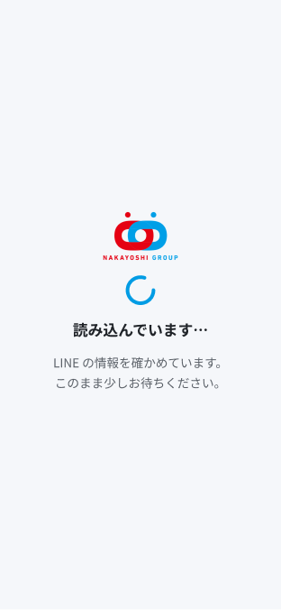</a> |
| 自分の会社のメンバーとして登録したい | 全員 | 招待コードの入力、または会社を探して紐付けを申請。本部が承認するまで「承認待ち」を表示 | S-02・S-03 | 確定 | <a href="assets/features/s02-register.png">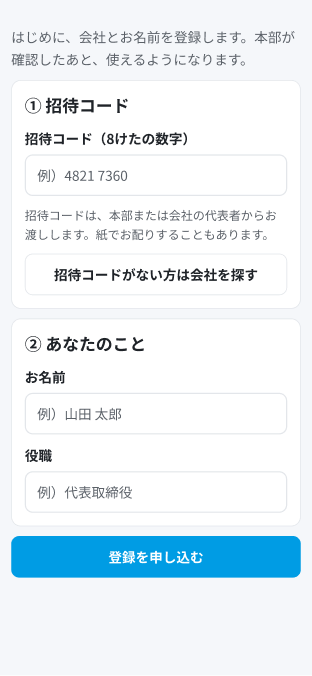</a> <a href="assets/features/s03-waiting.png">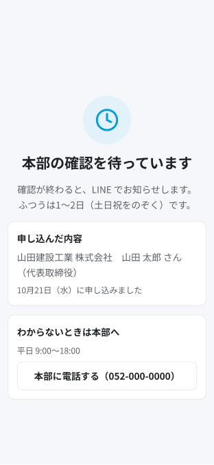</a> |
| 開いたらすぐ、次の予定と新しい知らせを見たい | 全員 | ホーム：いちばん上に次の予定（当日は Zoom に入るボタン）、その下に新しいお知らせ・申し込めるセミナー・アーカイブ | S-04 | 確定（変更あり） | <a href="assets/features/s04-home.png">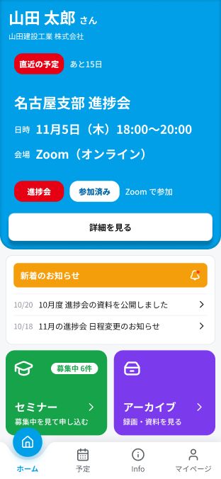</a> |
| セミナーを探して申し込みたい | 全員 | 予定一覧（セミナー）→ 詳細（種類・件名・日時・場所）→「HP で申し込む」で HP の申込ページへ移る。満席・締切の表示はなし | S-05・S-07 | 確定（変更あり） | <a href="assets/features/s05-seminars.png">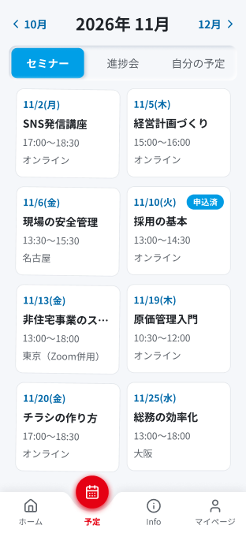</a> <a href="assets/features/s07-seminar.png">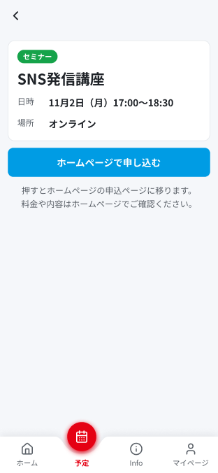</a> |
| ちゃんと申し込めたか確かめたい | 全員 | 申込済みの札（HP の申込をメールアドレスで結び付けて表示）、申し込み履歴 | S-07・S-20 | 確定（変更あり） | <a href="assets/features/s07-seminar-applied.png">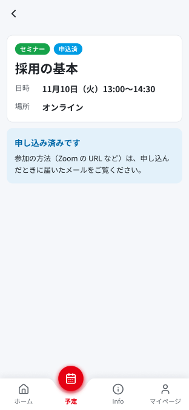</a> <a href="assets/features/s20-history.png">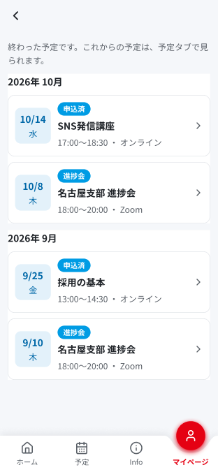</a> |
| 進捗会に参加したい | 社長・担当者・SV（一般社員には見えない） | 「進捗会に参加」→ 確認を1枚 → Zoom の URL 付きメールが届く。参加後は詳細画面からも Zoom に入れる。取り消しはできない（やめるときは本部へ連絡） | S-05・S-08 | 確定（変更あり） | <a href="assets/features/s05-progress.png">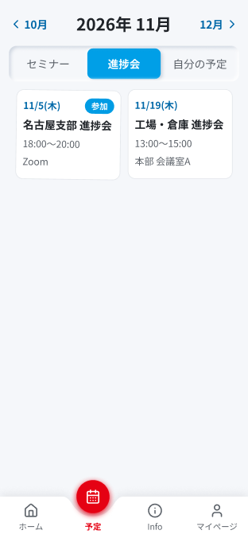</a> <a href="assets/features/s08-progress-confirm.png">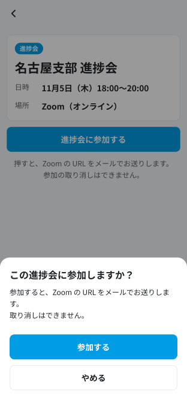</a> |
| 自分が出る予定だけをまとめて見たい | 全員 | 「自分の予定」：申し込んだセミナーと、参加を押した進捗会。予定タブは「セミナー／進捗会／自分の予定」の切り替え（一般社員は2つ） | S-06 | 確定（変更あり） | <a href="assets/features/s06-my-schedule.png">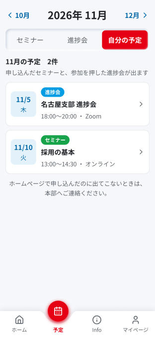</a> |
| 本部からのお知らせを読みたい | 全員 | Info タブ：お知らせの一覧と詳細（上にアーカイブの入口） | S-10・S-11 | 確定 | <a href="assets/features/s10-news.png">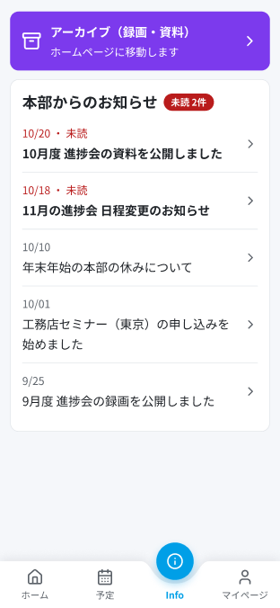</a> |
| 過去のセミナー資料を見たい | 全員 | アーカイブの入口（HP へ移動） | S-04・S-10 | 確定 |  |
| 同じ会社の人を確かめたい・誘いたい | 全員 | 会社情報とメンバー（氏名・役職・会社名・役割）、招待コードの表示。全加盟店を横断して探す名簿は作らない | S-12 | 確定 | <a href="assets/features/s12-company.png">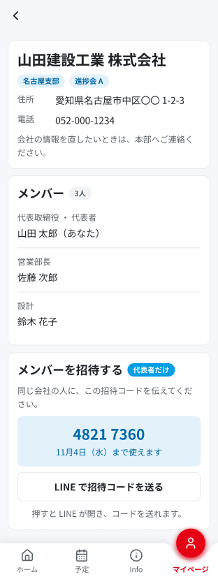</a> |
| 自分の情報や通知を直したい | 全員 | マイページ（氏名・役職・通知）、自分の情報を直す（メールを変えるときは確認メール）、ログアウト。細部は検討中 | S-13・S-21・S-22 | 確定 | <a href="assets/features/s13-mypage.png">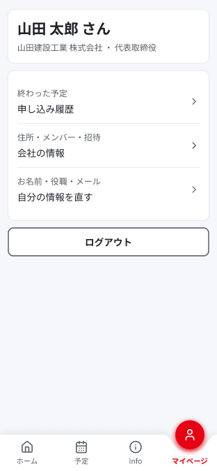</a> <a href="assets/features/s21-edit-profile.png">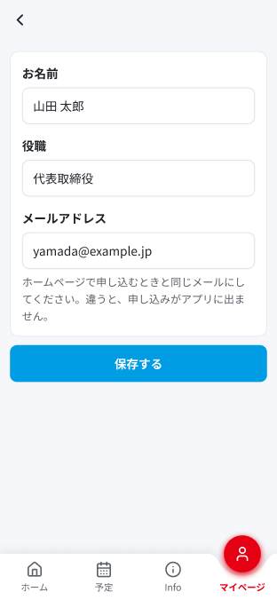</a> |
| オープンチャットに参加したい | 全員 | オープンチャットへの入口。Info タブに入れるかが未決 | 未作成 | 未決 | — |
| 担当している加盟店を見て、面談を記録したい | SV | 担当加盟店の一覧・詳細、面談記録の入力（第3弾） | S-14・S-15・S-16 | 確定 | <a href="assets/features/s14-sv-list.png">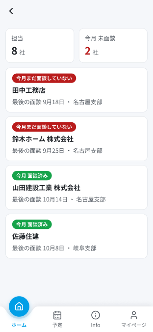</a> <a href="assets/features/s16-interview.png">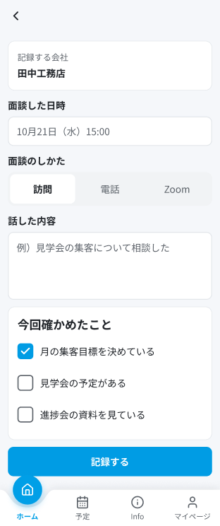</a> |
| 退会したあとに開いたら、何が起きたか分かるようにしたい | 退会・休会した人 | 使えないことの案内 | S-17 | 確定 | <a href="assets/features/s17-suspended.png">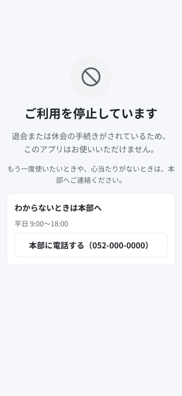</a> |
| うまく開けないときに、どうすればいいか知りたい | 全員 | エラー・メンテナンスの案内 | S-18 | 確定 | <a href="assets/features/s18-error.png">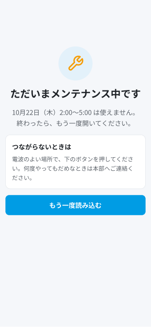</a> |
| スポンサー・支部長として使いたい | スポンサー・支部長 | スポンサーに見せる範囲と、支部長の画面をアプリに作るかが未決 | なし | 未決 | — |

## 裏側の仕組み（システムとしての機能）

画面には出ませんが、上の「やりたいこと」を支えるために必要な機能です。

| 仕組み | 支えるやりたいこと | 内容 | 状態 |
|---|---|---|---|
| 見せる範囲の判定 | 予定を見せる・進捗会に参加 | 役割ごとに見せるものを変える（一般社員には進捗会を出さない）。予定の対象は、支部・進捗会・スポンサー・部署のどれかに当てはまる人。対象を選ばない予定・下書き・「共有しない」は本部だけ | 確定（変更あり） |
| LINE の配信と通数の数え上げ | LINE で知らせる・通数の管理 | 送る前に相手の人数と送ったあとの残り通数を計算。承認済みの人だけを数える。月ごとの通数を記録 | 確定 |
| HP の申込の受け取りと結び付け | 申込の取り込み・申込済みの表示 | 申込フォームからの通知（Webhook）を受け取り、メールアドレスで利用者と結び付ける。結び付かない申込は本部の確認待ちに回す（進め方は未決） | 一部未決 |
| 進捗会の参加とメール送信 | 進捗会に参加 | 参加を押した人を申込者として記録し、Zoom の URL 付きメールを送る | 確定（変更あり） |
| 管理画面のログイン（許可制） | 管理画面に入る人を絞る | 1回だけ使えるリンク（案内 24時間・再設定 1時間）。期限切れのリンクから、ボタン1つで送り直し。パスワードの決まりと安全な保存 | 確定（変更あり） |
| 退会したときの自動停止 | 退会者が見られないようにする | 配信の相手から外し、アプリを開けなくする。個人を特定する情報は、報告を受けて本部が消す | 確定 |
| 操作の記録 | あとで調べる | 誰がいつ何をしたかを残す | 確定 |
| Zoom の参加者の取り込み | 出席を知る | 会議のあとに参加者を取り、会員と照らし合わせる。方式は検討中 | 未決 |
| 役割ごとの権限 | SV・支部長の使い方 | SV・支部長は加盟店の情報を見るだけ（確定）。編集の一部を任せるかは未決 | 一部未決 |

## この一覧に入れていないもの（やらないこと）

売上・会費・会計・請求・決済の管理、これまでの連絡ツールの過去ログの移行、既存のアーカイブサービスの置き換え、HP（公開サイト）の改修、加盟店個人のカレンダーへの自動登録、全加盟店を横断する検索名簿は対象外です（[1章](01-purpose-scope.html#やらないこと)）。

[← トップへ](./)
