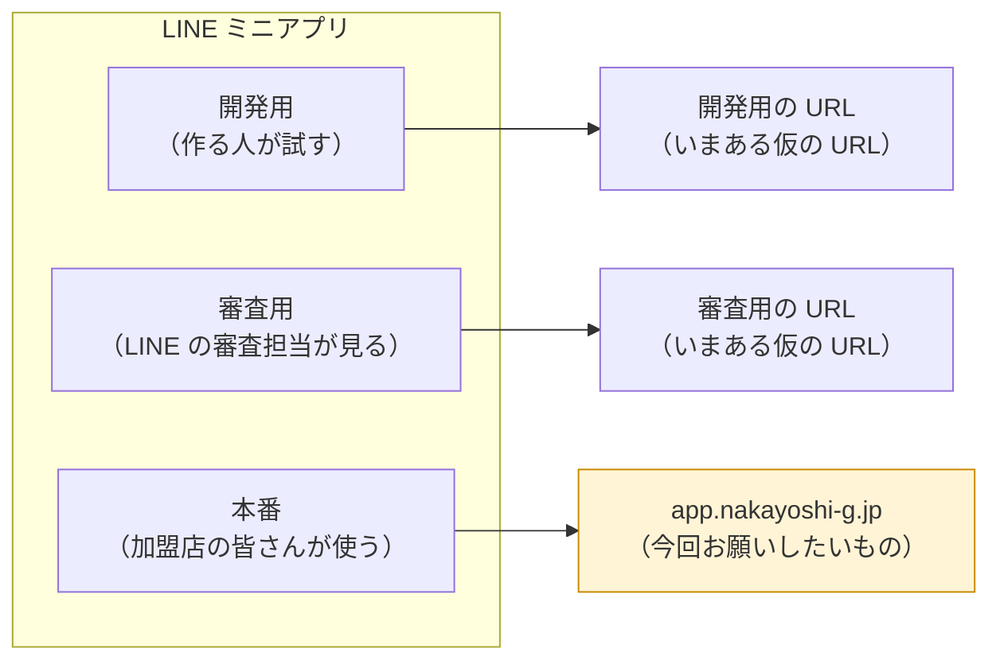
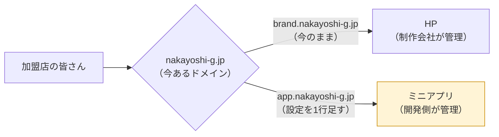
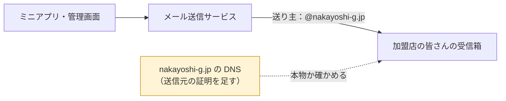
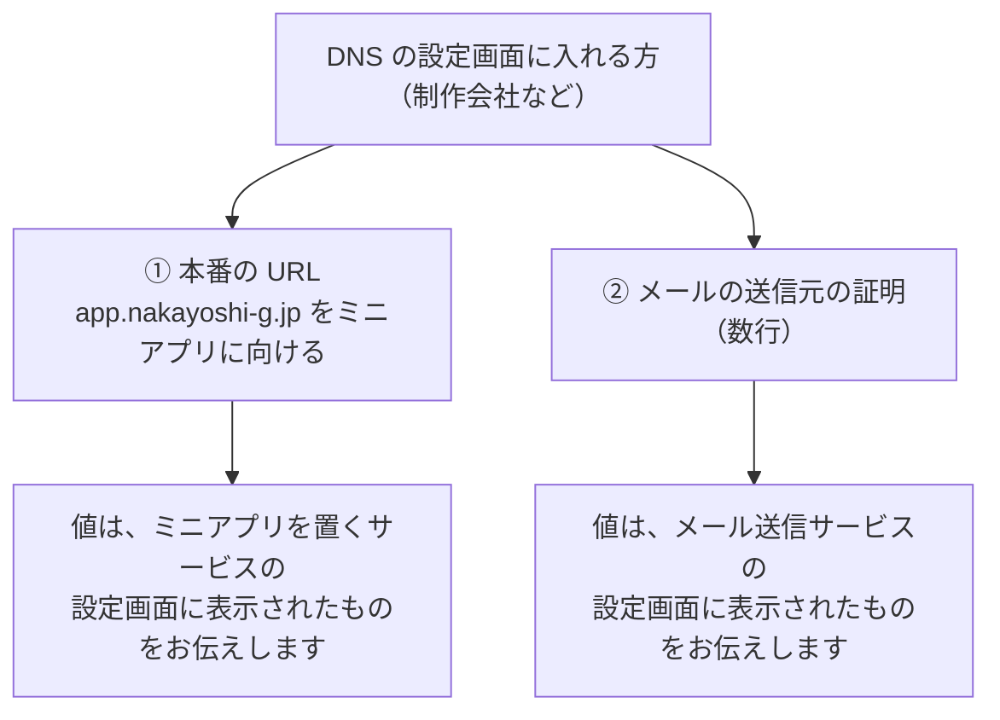
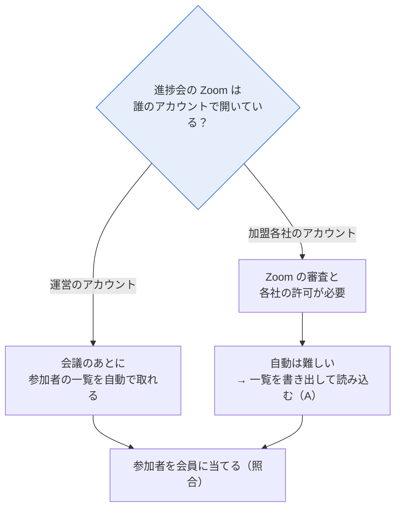
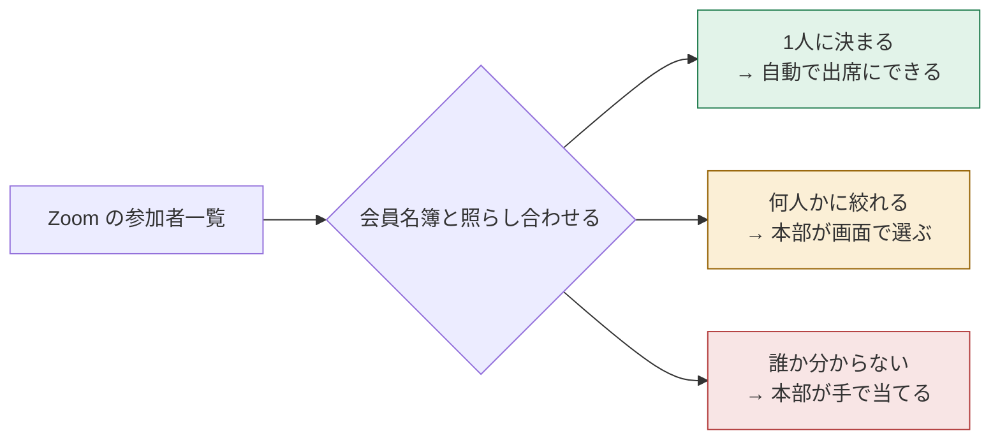
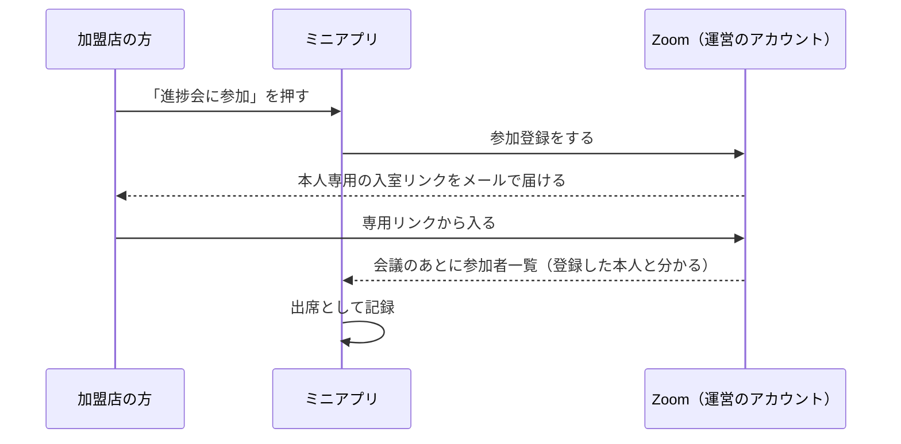
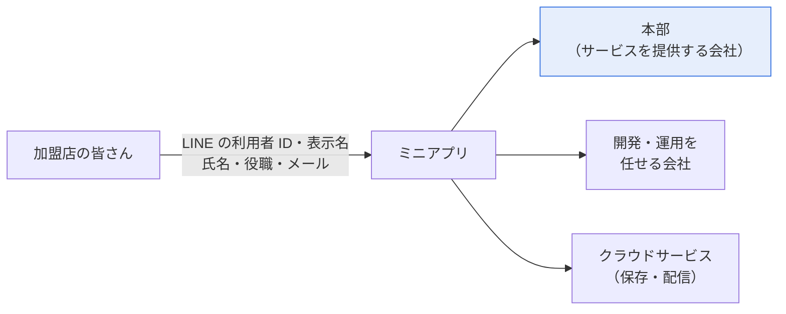
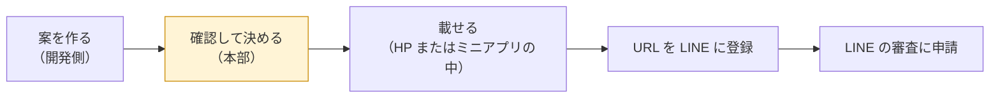

[← トップへ](./)

# 9. 10/29 聞くこと

**この章で分かること**  
2026-10-29 の打ち合わせで確認したいことと、それぞれ決まると何が進むかが分かります。

2026-10-28 作成。

## 1. ミニアプリの本番 URL に使うドメイン

LINE ミニアプリには、開発・審査・本番の3つの URL を設定します。加盟店の皆さんが使う本番の URL には、HP と同じドメインの下に、ミニアプリ用の名前を1つ作って使いたいと考えています（例：`app.nakayoshi-g.jp`）。HP と同じ名前なので、本物のアプリだと分かりやすく、新しいドメインの費用もかかりません。

本番の URL を使えるようにするには、HP の制作会社に、ドメインの行き先の設定（DNS）を1行足してもらう必要があります。HP 本体には手を入れません。

### メールを送るための設定も一緒にお願いしたい

アプリからは、進捗会の Zoom の URL や、管理画面のログイン用のリンクをメールで送ります。`@nakayoshi-g.jp` のアドレスから送ったメールが迷惑メールにならないように、「このサービスから送ったメールは本物です」という証明（送信元の証明）を DNS に足す必要があります。

いま会社で使っているメール（`@nakayoshi-g.jp` の送受信）には影響しない形で足します。本番の URL の設定と同じ画面で作業できるので、まとめて1回でお願いしたいです。

### お願いしたい設定のまとめ

聞くこと

- [ ] 本番の URL に、HP と同じドメインの下の名前を使ってよいか。名前は `app.nakayoshi-g.jp` でよいか
- [ ] メールの送り主のアドレス（例：`noreply@nakayoshi-g.jp`）。返信を受ける窓口も決めたい
- [ ] DNS の設定画面に入れるのは誰か（制作会社か、本部か）。①と②をまとめて頼めるか、いつまでにできそうか
- [ ] 設定する値は、こちらで用意してお伝えする。その渡し方（メールなど）
- [ ] メール送信サービスを、どなたの名義で契約するか

決まると進むこと：本番の URL が決まり、LINE の審査を申請できる準備がそろいます。メールも迷惑メールになりにくい形で送れるようになります。審査に通ったあとで本番の URL を変えると、もう一度審査が必要になるため、申請の前に決めておきたいです。

## 2. Zoom の参加者の取り込み

進捗会に Zoom で入った人を、アプリの会員と結び付けて「出席」として残せるかを検討しています。アプリの「進捗会に参加」で分かるのは申込（押した人）までで、本当に Zoom に入ったか（出席）は分かりません。

難しさは、進捗会の Zoom を誰のアカウントで開いているかで大きく変わります。

- **運営のアカウントで開いている場合**：会議のあとに参加者の一覧を自動で取れます。残る課題は、参加者を会員の誰に当てるか（照合）だけです。
- **加盟各社のアカウントで開いている場合**：Zoom の審査や各社の許可が必要になり、自動で取るのは難しくなります。

照合の結果は、次の3つに分かれます。Zoom にログインせずに入った人や、ニックネームで入った人は、誰か分からないことが多くなります。どれくらい手作業が残るかは、実際の参加者の一覧で確かめないと分かりません。

「1人に決まる」を増やす方法として、参加登録を使う案があります。アプリで「進捗会に参加」を押したときに、その人専用の入室リンクをメールで送ります。専用リンクから入った人は、表示名がニックネームでも誰か分かります。

聞くこと

- [ ] 進捗会の Zoom は、運営のアカウントで開いているか
- [ ] SV や加盟店が、自分の Zoom で進捗会を開くことはあるか（その会は自動では取れません）
- [ ] 同じ時間に重なる進捗会は、最大でいくつか（重なる数だけ Zoom の契約が必要です）
- [ ] 過去の進捗会1回分の参加者一覧（CSV）を書き出してもらえるか（照合したとき、手作業がどれくらい残るかを数えるため）
- [ ] Zoom の「参加登録」をオンにしてよいか（会員一人ずつに専用の入室リンクを送れば、確実に1人に決まります）
- [ ] 出席が分かったら、誰が何に使うか（出欠表はやめることにしたため、使い道を確かめたいです）
- [ ] どの方式で進めるか
  - A：会議のあと、開いた人が参加者一覧を書き出して、管理画面に読み込む
  - B-1：すべての会議を運営のアカウントで開き、自動で取り込む
  - B-2：進捗会だけ運営のアカウントで開き、自動で取り込む
  - C：各社の Zoom とつなぐ（Zoom の審査と各社の許可が必要）

決まると進むこと：出席を取るかどうかと、その方式が決まり、管理画面の画面と作業の量が決まります。

## 3. ミニアプリ用のプライバシーポリシー

LINE ミニアプリの審査では、次のことが求められます。

- プライバシーポリシーに書かれた会社名が、LINE の申請者名（プロバイダー名）と同じであること
- アプリで扱う情報と、それを第三者に渡す場合は、その渡し先を書いてあること（開発会社とサービスを提供する会社が違う場合は、とくに必要です）

いまの HP のプライバシーポリシーは、資料請求やお問い合わせで受け取る情報についての内容で、会社名も書かれていません。そのため、ミニアプリ用のプライバシーポリシーが別に必要です。

図の右側の渡し先すべてを、プライバシーポリシーに書く必要があります。申請までの流れは次のとおりです。

ミニアプリ用に書く予定の内容

- 正式な会社名（申請者名と同じ表記）
- 受け取る情報（LINE の利用者 ID・表示名、氏名・役職・メールアドレス、申込の履歴など）
- 使う目的（予定やお知らせの表示、申込状況の表示、本部からの連絡）
- 第三者への提供（開発・運用を任せる会社、使っているクラウドサービス）
- 退会したときの情報の扱い
- お問い合わせ先

聞くこと

- [ ] 正式な会社名の表記（申請者名もこれにそろえます）
- [ ] 案はこちらで作るので、確認して決めてもらえるか。誰が確認するか
- [ ] どこに載せるか（HP に新しいページを足す場合は制作会社への依頼、またはミニアプリの中に置く）
- [ ] お問い合わせ先として載せる窓口（部署名・メールアドレスなど）

決まると進むこと：LINE の審査に出すための書類がそろいます。

[← トップへ](./)
