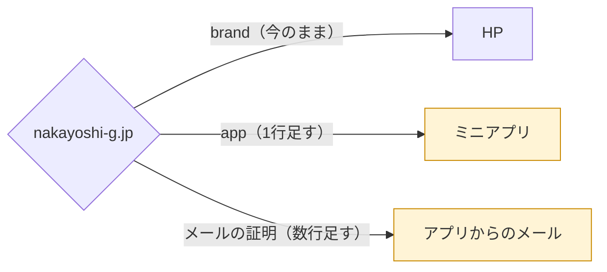
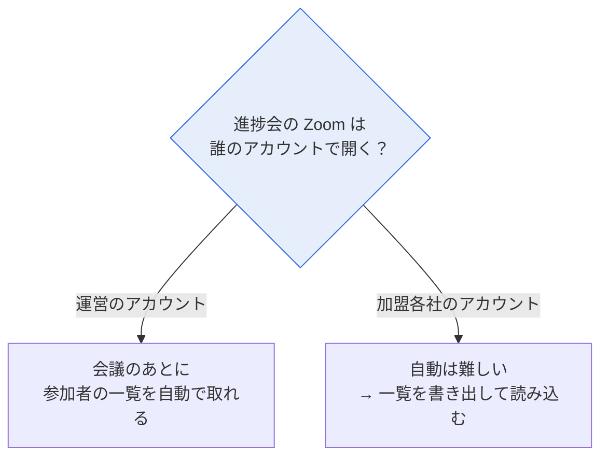

[← トップへ](./)

# 9. 10/29 聞くこと

**この章で分かること**  
2026-10-29 の打ち合わせで確認したいことが分かります。

## 1. ドメインの設定（DNS）

加盟店の皆さんが使う本番の URL を `app.nakayoshi-g.jp` にしたいと考えています。あわせて、アプリから `@nakayoshi-g.jp` で送るメールが迷惑メールにならないための設定もお願いしたいです。HP と会社のメールには影響しません。



### DNS に足す値

| 種別 | ホスト名 | 値 | 何のため |
|---|---|---|---|
| CNAME | `app` | `9fdf0003e66d15a5.vercel-dns-016.com` | 本番の URL |
| TXT | `_vercel` | `vc-domain-verify=app.nakayoshi-g.jp,04edf7602458c01350a0` | ドメインの持ち主の確認 |
| TXT | `resend._domainkey` | 下の「DKIM の値」 | メールの証明 |
| CNAME | `rsend` | `rsend-apne1.forge.rmta.net` | メールの証明 |
| CNAME | `send` | `send.forge.rmta.net` | メールの証明 |
| TXT | `_dmarc` | `v=DMARC1; p=none;` | 任意（あると望ましい） |

DKIM の値（1行で貼り付け）

```
p=MIGfMA0GCSqGSIb3DQEBAQUAA4GNADCBiQKBgQC1JPlvNfkj+rrOzC3p99BY9aYvi3LEwrbjUWMGuRENzAFtaPtxtGmSjk6ReKaw4FET76QAZnzqIHkbfR6F17hXimqxEECT1tzKAZVMZjogyKYWhsTuAddLdSrCE9FmLXFCxt6V9H7hTF8HAXvsR7zI8E4OYbj1wsIbaIuGIn8k5QIDAQAB
```

TTL は初期値のままで大丈夫です。

### 聞くこと

- [ ] `app.nakayoshi-g.jp` を使ってよいか
- [ ] DNS を設定できるのは誰か（制作会社か本部か）。いつまでにできるか
- [ ] メールの送り主のアドレス（例：`noreply@nakayoshi-g.jp`）

審査に通ったあとで本番の URL を変えると、もう一度審査が必要になります。申請の前に決めたいです。

## 2. Zoom の出席の取り込み

アプリの「参加する」で分かるのは申込までです。本当に Zoom に入ったか（出席）を取るかどうかを決めたいです。進捗会の Zoom を誰のアカウントで開くかで、できることが変わります。



### 聞くこと

- [ ] 進捗会の Zoom は、運営のアカウントで開いているか
- [ ] 同じ時間に重なる進捗会は、最大でいくつか（重なる数だけ Zoom の契約が要ります）
- [ ] 出席が分かったら、誰が何に使うか
- [ ] 過去の進捗会1回分の参加者一覧（CSV）をもらえるか（自動でどれくらい当てられるか試すため）

## 3. ミニアプリ用のプライバシーポリシー

LINE の審査には、ミニアプリ用のプライバシーポリシーが必要です。いまの HP のものは資料請求向けの内容で、会社名も書かれていないため、別に作ります。案は開発側で作ります。

### 聞くこと

- [ ] 正式な会社名（LINE の申請者名もこれにそろえます）
- [ ] 案を確認して決める方
- [ ] 載せる場所（HP に足すか、ミニアプリの中に置くか）
- [ ] お問い合わせ先として載せる窓口

## 4. スポンサーはミニアプリを使うか

いまは、加盟店の社長・担当者、一般社員、SV が使う前提で画面を作っています。

### 聞くこと

- [ ] スポンサーの方も、ミニアプリを使うか（LINE の配信だけでよいか）
- [ ] 使う場合、何を見せるか（スポンサー向けの予定・お知らせだけでよいか）

[← トップへ](./)
