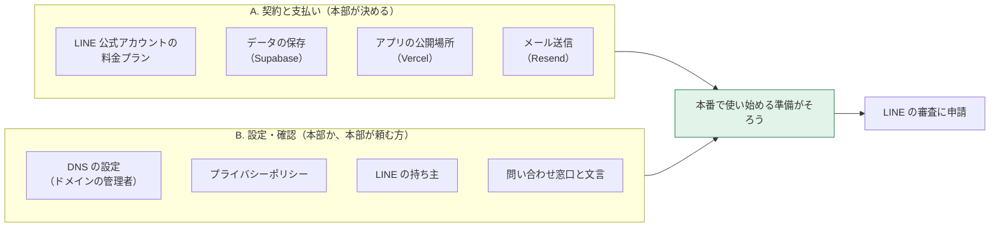

[← トップへ](./)

# 10. 先方にお願いすること

**この章で分かること**  
本番で使い始めるために、本部（または本部が頼む方）にしかできない作業と、決めていただくことが分かります。

2026-10-28 作成。Zoom のアカウントの費用は、この章には含めません。

## 全体の流れ

## A. 契約と支払い

### 毎月の費用（2026-10-28 時点・公式の料金表より）

| サービス | 何に使うか | 本番での目安 |
|---|---|---|
| LINE 公式アカウント | LINE での配信 | 月15,000円（税別）・月30,000通まで |
| Supabase | データの保存とログイン | 月25ドル〜 |
| Vercel | アプリを公開する場所 | 月20ドル |
| Resend | メール送信 | 月3,000通までは0円。超えたら月20ドル |

ドル建ては為替で円の金額が変わります。料金は変わることがあるので、契約の前に公式の料金ページで確かめてください。

出典：[LINE](https://www.lycbiz.com/jp/service/line-official-account/plan/)・[Supabase](https://supabase.com/pricing)・[Vercel](https://vercel.com/pricing)・[Resend](https://resend.com/pricing)

### 決めていただくこと

- [ ] それぞれ、**誰の名義で契約し、誰が払うか**
- [ ] **LINE のプラン**（加盟店の人数と、月に送る回数で決まります）

## B. 設定と確認

### 1. DNS の設定

- [ ] `nakayoshi-g.jp` の DNS を設定できる方（制作会社など）に、[9章の表](09-questions-1029.html#1-ミニアプリの本番-url-に使うドメイン) の値を足していただく。誰に頼むか、いつまでにできるか

### 2. プライバシーポリシー

- [ ] 正式な会社名
- [ ] 開発側が作る案を確認する方と、載せる場所

### 3. LINE の持ち主

- [ ] **LINE 公式アカウントの管理者になる方を決める**（開発側から招待を送ります。届いたら受けてください）

LINE からの連絡（審査の結果など）は本部に届きます。届いたら、開発側にも教えてください。

### 4. アプリに出す連絡先と文言

- [ ] 本部の電話番号と、受け付ける時間
- [ ] 招待コードを LINE で送るときの文

[← トップへ](./)
