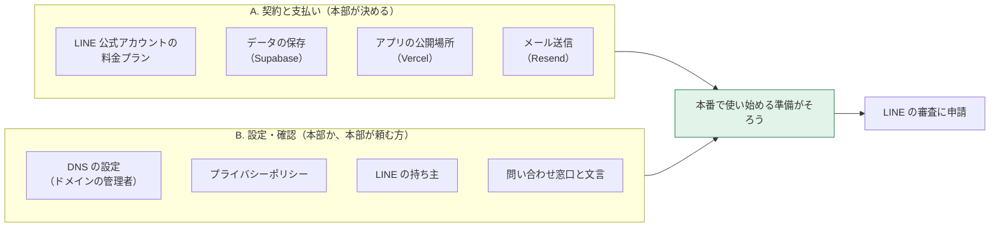

[← トップへ](./)

# 10. 先方にお願いすること

**この章で分かること**  
本番で使い始めるために、本部（または本部が頼む方）にしかできない作業と、決めていただくことが分かります。

2026-10-28 作成。Zoom のアカウントの費用は、この章には含めません。

## 全体の流れ

## A. 契約と支払い

どのサービスも「誰の名義で契約し、誰が支払うか」を決めていただく必要があります。

### 毎月かかる費用（各サービスの公式の料金表より・2026-10-28 時点）

| サービス | 何に使うか | 小さく始める場合 | 本番での目安 |
|---|---|---|---|
| LINE 公式アカウント | 加盟店への LINE での配信 | コミュニケーション：0円（月200通まで・追加の送信はできない） | スタンダード：月15,000円（税別）・月30,000通まで。超えた分は1通あたり最大約3円（税別） |
| Supabase | 会員・予定・申込などのデータの保存とログイン | Free：0ドル（バックアップなし・1週間使わないと止まる） | Pro：月25ドル〜（毎日のバックアップを7日分） |
| Vercel | アプリを公開する場所 | Hobby：0ドル（個人・非商用向けのため、本番では使えない） | Pro：月20ドル（1人分） |
| Resend | アプリからのメール送信 | Free：0ドル（1日100通・月3,000通まで） | 通数が増えたら Pro：月20ドル（月50,000通まで） |

- ドル建ての料金は、その月の為替で円の金額が変わります。
- LINE には、中間のライトプラン（月5,000円（税別）・月5,000通まで）もあります。
- 料金は各サービスが変えることがあります。契約の前に、それぞれの公式の料金ページで確かめてください。

出典：[LINE 公式アカウントの料金プラン](https://www.lycbiz.com/jp/service/line-official-account/plan/)・[Supabase](https://supabase.com/pricing)・[Vercel](https://vercel.com/pricing)・[Resend](https://resend.com/pricing)

### 決めていただくこと

- [ ] **LINE の料金プラン**：どのプランにするか（加盟店の人数と、月に送る回数で決まります）。支払いの方法
- [ ] **Supabase**：本番は Pro にするか（バックアップがあり、止まらないため、本番には Pro をおすすめします）。名義と支払い
- [ ] **Vercel**：いまは開発側のアカウントで動かしています。このまま開発側で持つか、本部の名義に移すか。費用をどちらが持つか
- [ ] **Resend**：いまは開発側のアカウントで用意しています（無料の範囲）。名義をどうするか。通数が増えたときに有料にするか

## B. 設定と確認

### 1. DNS の設定（ドメインの管理者）

`nakayoshi-g.jp` の DNS の設定画面に入れる方（制作会社など）に、設定を足していただきます。足す値は [9章「10/29 聞くこと」](09-questions-1029.html#1-ミニアプリの本番-url-に使うドメイン) にまとめてあります。

- [ ] 本番の URL 用の2行（CNAME `app`、TXT `_vercel`）
- [ ] メール送信用の3行（TXT `resend._domainkey`、CNAME `rsend`、CNAME `send`）と、任意の1行（TXT `_dmarc`）
- [ ] 誰に頼むか、いつまでにできるか

### 2. プライバシーポリシー

LINE ミニアプリの審査には、ミニアプリ用のプライバシーポリシーが必要です（くわしくは [9章](09-questions-1029.html#3-ミニアプリ用のプライバシーポリシー)）。

- [ ] 正式な会社名（LINE の申請者名もこれにそろえます）
- [ ] 開発側が作る案を確認して、決めていただく方
- [ ] 載せる場所（HP に新しいページを足す場合は、制作会社への依頼）

### 3. LINE の持ち主

- [ ] **LINE 公式アカウントの管理者になる方を決める**（開発側から招待を送ります。届いたら受けてください）

LINE からの連絡（審査の結果など）は本部に届きます。届いたら、開発側にも教えてください。

### 4. 問い合わせ窓口と文言

アプリの画面には、本部への連絡先や、本部が決める文言が出ます。いまは仮の内容です。

- [ ] **本部の電話番号**：「本部に電話する」ボタン（利用停止の画面）に出す番号と、受け付ける時間
- [ ] **招待コードを送る文面**：社長・担当者が同じ会社の方に LINE で招待コードを送るときの文

[← トップへ](./)
