[← トップへ](./)

# 11. Vercel と Supabase のアカウントの作り方

**この章で分かること**  
アプリを動かすための2つのサービスを、本部の名義で契約する手順が分かります。どちらも15分ほどで終わります。

| サービス | 何に使うか | 月の費用 |
|---|---|---|
| Vercel | アプリを公開する場所 | 40ドル（本部1人＋開発側1人） |
| Supabase | データの保存とログイン | 25ドル〜（人数で増えません） |

2026-10-29 作成。画面は英語です。押すところは、画面に出る英語のまま **太字** で書いています。画像の中のメールアドレスやカードの情報は、見本に置き換えたり、ぼかしたりしています。

## 全体の流れ

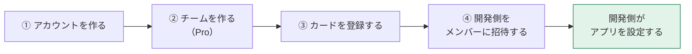

Vercel と Supabase で同じ流れです。①〜④を本部でしていただき、そのあとは開発側が行います。**カードの番号は、開発側には伝わりません。**

## 用意するもの

- 本部のメールアドレス（今後、お知らせと請求書が届きます。担当の方が替わっても見られる共有のアドレスがおすすめです）
- 会社のクレジットカード
- 開発側のメールアドレス（別にお知らせします）

---

## A. Vercel

### ① アカウントを作る

1. パソコンで [https://vercel.com/signup](https://vercel.com/signup) を開き、いちばん下の **Continue with Email** を押します。

   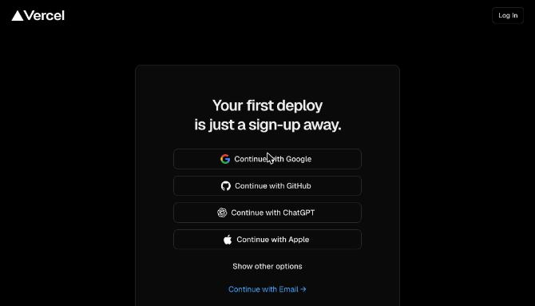

2. 本部のメールアドレスを入れて、**Continue with Email** を押します。

   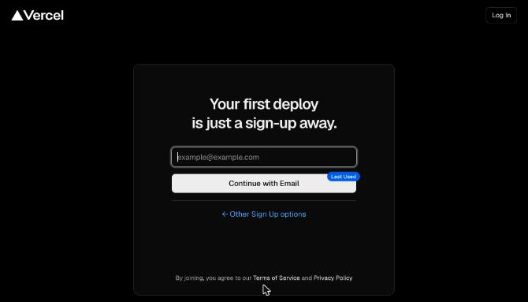

3. メールに届いた **6桁の数字** を入れます。これでアカウントができます。ログインのたびに、メールに6桁の数字が届きます。

> 途中で使い方やプランを聞かれたら、仕事用（**Pro**）を選びます。「Git」や「GitHub」とつなぐ画面が出たら、つながずに先へ進んでください（開発側が行います）。

### ② チームを作る（Pro）

1. 画面の左上のチーム名の右にある **⌃⌄** を押し、一覧のいちばん下の **Create Team** を押します。

   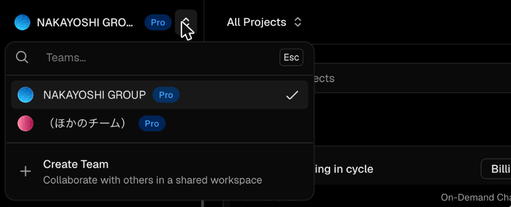

2. **Team Name** に「NAKAYOSHI GROUP」と入れ、右の **Pro** を選んで、**Continue** を押します。

   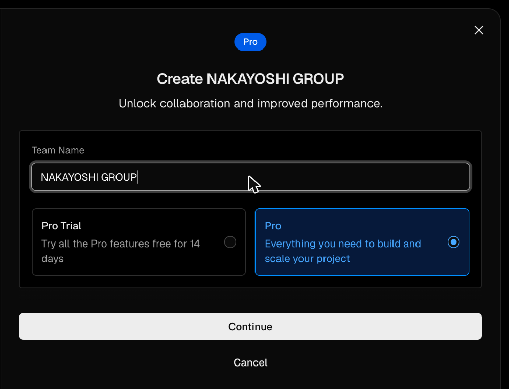

   > 左の **Pro Trial**（14日間の無料お試し）ではなく、右の **Pro** を選んでください。お試しのあとに止まってしまうのを防ぐためです。

3. 続けて支払いの画面が出たら、そのまま ③ のカードの登録に進みます。

### ③ カードを登録する

1. 左上でチーム「NAKAYOSHI GROUP」が選ばれていることを確かめます。
2. 左の **Settings** → **Billing** を開き、**Payment Method** の **Add Card** を押して、カードの情報を入れます。

   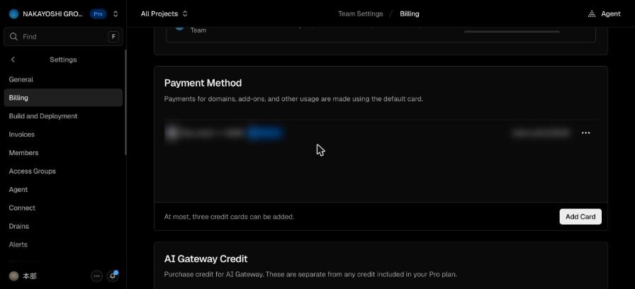

3. 同じ画面の下の方の **Invoice Email Recipient** に、請求書を受け取るメールアドレスを入れておくと、経理の方に届きます。

### ④ 開発側をメンバーに招待する

1. 左の **Settings** → **Members** を開きます。
2. **Email Address** に開発側のメールアドレスを入れ、**Role** は **Member** のまま、**Invite** を押します。

   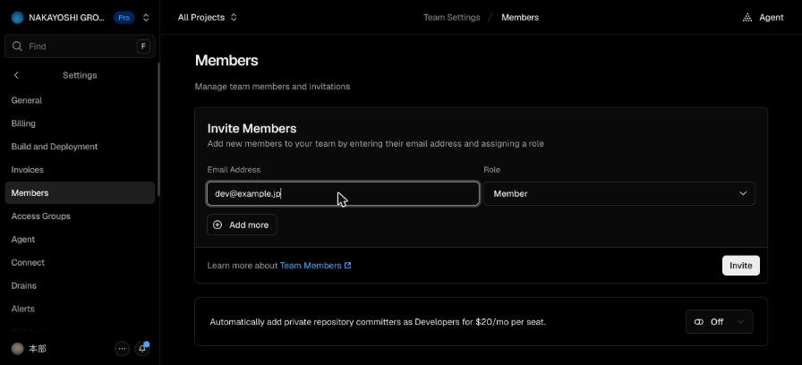

   > **Role** は **Member** にしてください。**Viewer** だと、開発側がアプリを移したり直したりできません。

3. 開発側に「招待しました」とご連絡ください。招待の有効期限は7日間です。

---

## B. Supabase

### ① アカウントを作る

1. パソコンで [https://supabase.com/dashboard/sign-up](https://supabase.com/dashboard/sign-up) を開きます。
2. 下の **Email** に本部のメールアドレス、**Password** にパスワードを入れて、**Sign up** を押します（上の GitHub などのボタンは使いません）。
3. 届いたメールの確認のリンクを押すと、アカウントができます。

### ② 組織を作る（Pro）

Supabase では、チームのことを「組織（Organization）」と呼びます。

1. ログインすると組織の一覧が出ます。右上の **New organization** を押します。

   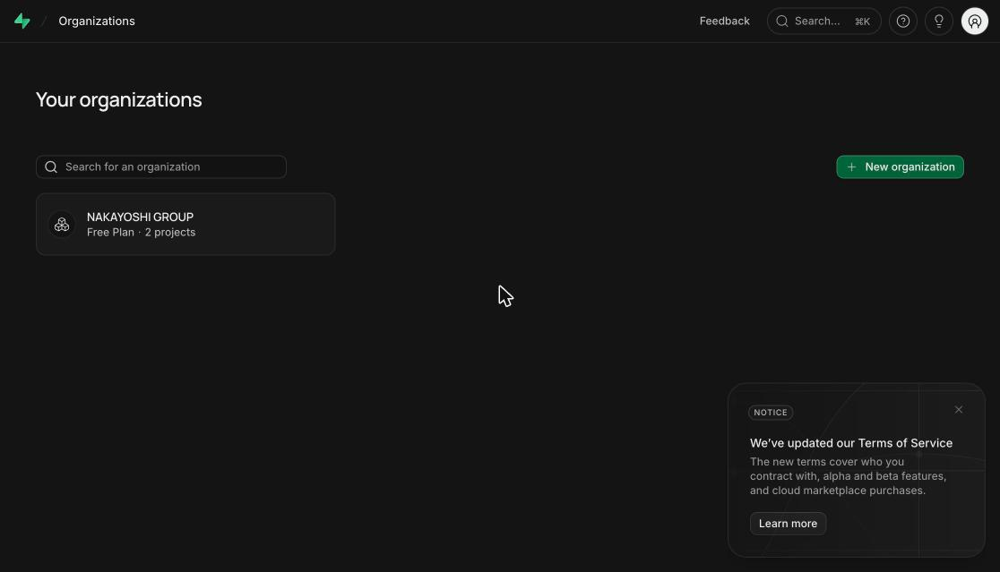

2. 次のように入れます。

   | 項目 | 入れるもの |
   |---|---|
   | **Name** | NAKAYOSHI GROUP |
   | **Type** | **Company** |
   | **Company size** | 会社の人数に近いもの |
   | **Plan** | **Pro - $25/month** |

   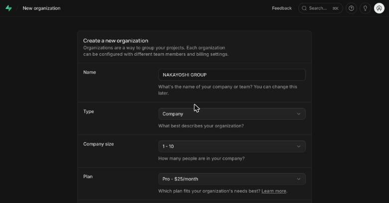

### ③ カードを登録する

1. **Plan** で Pro を選ぶと、下にカードを入れる欄が出ます。**Spend Cap** はオン（緑）のままにします。使いすぎても、決まった料金より高くならないようにする設定です。

   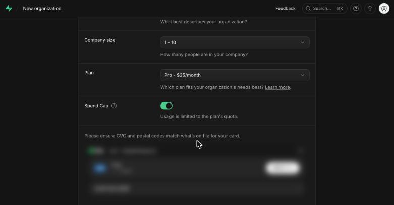

2. カードの情報と請求先を入れます。会社として払うときは **I'm purchasing as a business** にチェックを入れ、会社名を入れます。
3. 右下の **Create organization** を押します。

   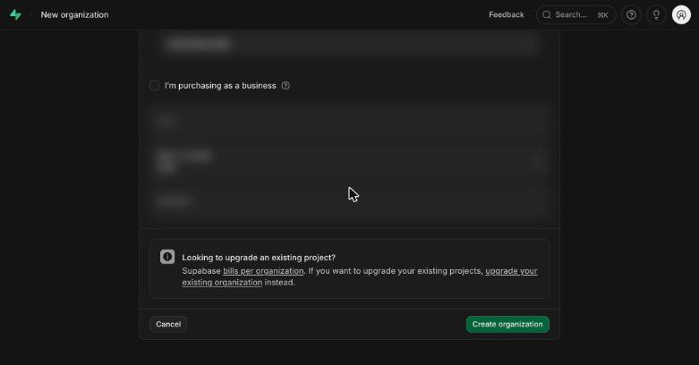

### ④ 開発側をメンバーに招待する

1. 左の人のアイコン（**Team**）を開き、右上の **Invite members** を押します。

   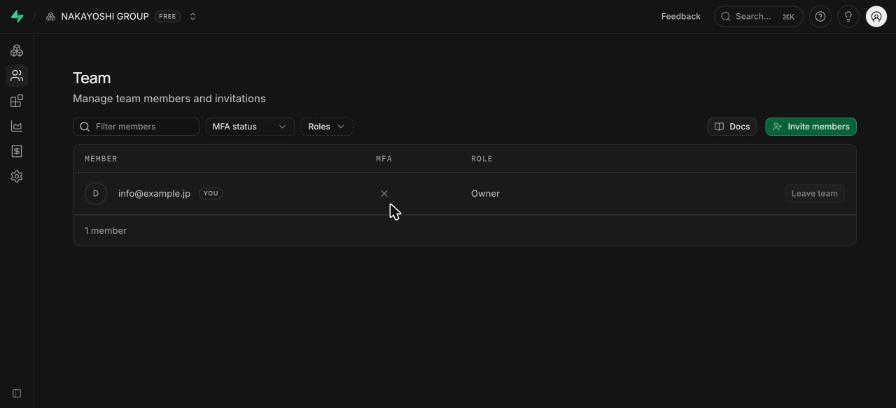

2. 役割は **Administrator** を選び、**Email addresses** に開発側のメールアドレスを入れて、**Send invitation** を押します。

   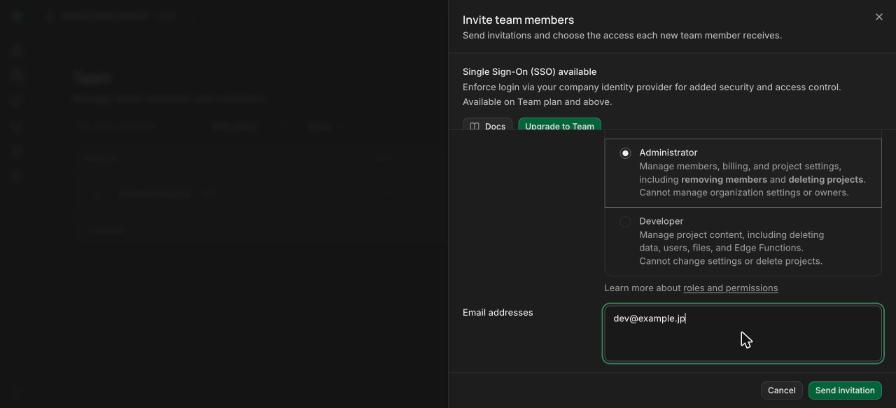

   > 役割は **Administrator** にしてください。**Developer** だと、開発側がデータベースの設定を変えられません。

3. 開発側に「招待しました」とご連絡ください。

---

## 費用のまとめ

| サービス | 中身 | 月の費用 |
|---|---|---|
| Vercel | Pro の基本料金（本部の1人分と、月20ドル分の使用量を含む）＋開発側1人分 | 40ドル |
| Supabase | Pro（データベース1つ分を含む）。メンバーの人数で料金は増えません | 25ドル〜 |

- 税別です。ドル建てなので、為替で円の金額が変わります。
- 使う量が多いと、追加の料金がかかることがあります。

出典：[Vercel の Pro プラン](https://vercel.com/docs/plans/pro-plan)・[Vercel のメンバーの招待](https://vercel.com/docs/rbac/managing-team-members)・[Supabase の料金](https://supabase.com/pricing)・[Supabase の役割](https://supabase.com/docs/guides/platform/access-control)

## 招待のあとに開発側が行うこと

- **Vercel**：いまのアプリを本部のチームへ移します。移しているあいだも、アプリは止まりません。アプリの設定とドメイン（`app.nakayoshi-g.jp`）も一緒に移るので、DNS の設定はそのままで大丈夫です。
- **Supabase**：本部の組織の中に、本番用のデータベースを作ります。

[← トップへ](./)
